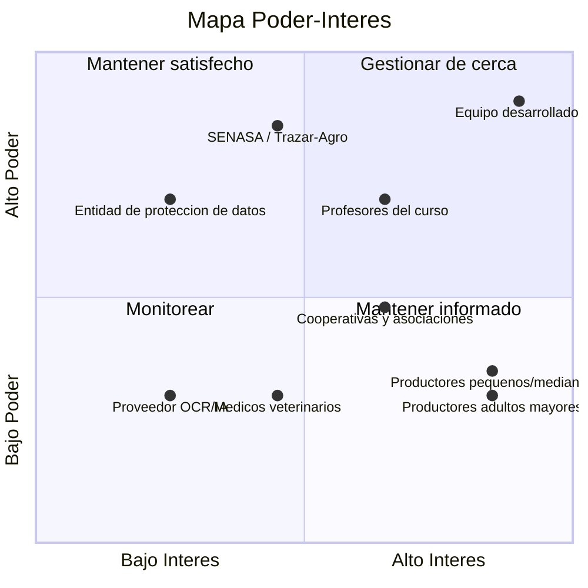

# Plataforma de Registro Individual de Ganado

## Sección 00 — Portada e identificación del equipo

**Proyecto final — ISW-912 · Administración de Proyectos Informáticos**
Universidad Técnica Nacional · Sede Regional de San Carlos · II Cuatrimestre 2026

**Estudiantes:** Marco López Quesada · Joseph Salazar Araya
**Profesores:** Yesenia Calvo Araya · Deiver Cubero Molina

### Definición del Scrum Team

| Rol | Integrante | Responsabilidades principales |
|---|---|---|
| Product Owner | Marco López Quesada | Define y prioriza el Product Backlog; representa la visión del producto y las necesidades de los productores; decide qué se construye en cada Sprint. |
| Scrum Master | Joseph Salazar Araya | Facilita el proceso Scrum; da seguimiento al Sprint Backlog; elimina obstáculos del equipo; organiza Sprint Planning, Daily Scrum, Sprint Review y Retrospective. |
| Developer 1 | Developer 1 | Modelo de datos y registro individual: modelo multi-especie, propietario por cédula, ficha por animal y código único. |
| Developer 2 | Developer 2 | Módulo de asistencia por IA: lectura del arete mediante OCR y sugerencia de raza y color/patrón, con corrección manual. |
| Developer 3 | Developer 3 | Interfaz simple y validación: pasos guiados y mínima digitación, validados con productores reales o simulados. |

> El equipo está integrado por dos estudiantes: Marco López Quesada y Joseph Salazar Araya.
> Developer 1, Developer 2 y Developer 3 son etiquetas genéricas autorizadas por la
> profesora para distribuir las líneas de trabajo; no representan a estudiantes adicionales.

Duración del equipo: 14 semanas, correspondientes a la duración completa del curso.

---

## Sección 01 — Problema, oportunidad y Product Goal

### Acta de Inicio (Project Charter)

#### Justificación del proyecto

En Costa Rica, el sistema nacional de trazabilidad Trazar-Agro está enfocado casi
exclusivamente en el cumplimiento sanitario y comercial del ganado bovino y porcino, sin
ofrecer a los productores —en particular a los pequeños y medianos, muchos de ellos
adultos mayores con poca familiaridad tecnológica— una herramienta de uso interno para
administrar el historial detallado de cada animal (salud, peso, reproducción,
fotografías, propietario). El registro manual del número de arete es, además, propenso a
errores de digitación, y la conectividad en las fincas rurales suele ser limitada.

El proyecto se justifica porque complementa, sin duplicar, el sistema oficial: ofrece a
los productores una plataforma propia para el control individual de su ganado, con una
interfaz simplificada y un módulo de inteligencia artificial que agiliza el registro
mediante fotografía (lectura del arete, sugerencia de raza y color/patrón), reduciendo el
tiempo y los errores de digitación, especialmente para usuarios con menor destreza
tecnológica.

#### Objetivo general

Desarrollar una plataforma digital que permita el registro y control individual detallado
del ganado en Costa Rica, organizado por categorías de especie y asociado a un propietario
mediante cédula, con generación automática de código único por animal y un módulo de IA
que agilice el registro mediante fotografía.

#### Objetivos específicos

1. Diseñar el modelo de datos multi-especie (bovinos, porcinos, equinos, etc.), incluyendo
   la entidad Propietario (cédula física o jurídica) vinculada a uno o varios animales,
   ficha detallada por animal, foto opcional y generación automática de código único.
2. Implementar un módulo de asistencia por IA que, a partir de la foto del animal,
   extraiga el número de arete mediante OCR cuando exista (usándolo como referencia si el
   animal ya está registrado oficialmente, o como base para iniciar su ficha si no lo
   está), y sugiera raza y color/patrón de pelaje como apoyo al llenado, con corrección
   manual en todos los casos.
3. Diseñar y validar una interfaz de uso simple (pasos guiados, mínima digitación) con
   productores reales o simulados, priorizando la accesibilidad para usuarios adultos
   mayores con poca experiencia en plataformas digitales.

#### Límites generales del proyecto

**Dentro del alcance**

- Registro y gestión de fichas individuales de ganado multi-especie (bovino, porcino,
  equino, etc.).
- Asociación de animales a un propietario mediante cédula física o jurídica.
- Generación automática de código único por animal.
- Módulo de IA/OCR para lectura de arete y sugerencia de raza/color-patrón a partir de
  fotografía.
- Interfaz simplificada orientada a productores con baja alfabetización digital.

**Fuera del alcance**

- Sustitución o duplicación del registro oficial de Trazar-Agro/SENASA.
- Procesos de pago, facturación o comercialización de ganado.
- Módulo veterinario avanzado (diagnósticos, historiales clínicos detallados) en esta
  fase.
- Soporte completamente offline; se asume conectividad intermitente, no ausencia total de
  red.

### Product Goal

Una plataforma digital de registro y control individual detallado del ganado en Costa
Rica, organizada por categorías de especie, con cada animal asociado a un propietario
mediante cédula, código único generado automáticamente y un módulo de IA que agilice el
registro mediante fotografía.

---

## Sección 02 — Contexto organizacional y restricciones

### Lean Canvas

| Bloque | Contenido |
|---|---|
| Problema | Falta de una herramienta interna, simple y detallada para el control individual del ganado; Trazar-Agro cubre solo trazabilidad sanitaria/comercial; alta tasa de error en digitación manual del arete. |
| Segmentos de clientes | Productores pequeños y medianos; productores adultos mayores; propietarios con varias especies en una misma finca. |
| Propuesta de valor única | Control individual y detallado del ganado, con registro asistido por IA que reduce tiempo y errores de digitación, complementando el sistema nacional sin duplicarlo. |
| Solución | Plataforma multi-especie con ficha por animal, código único, asociación a propietario por cédula y módulo de IA/OCR para lectura de arete y sugerencia de raza/color-patrón. |
| Canales | Aplicación web/móvil; difusión a través de cooperativas y asociaciones de productores agropecuarios. |
| Flujos de ingreso | Proyecto académico, sin modelo de ingresos definido en esta etapa. |
| Estructura de costos | Tiempo de desarrollo de los dos estudiantes del equipo; hosting; costo de servicios de OCR/IA en la nube. |
| Métricas clave | Número de animales registrados; tasa de precisión del OCR; tasa de adopción en pruebas con usuarios reales o simulados. |
| Ventaja injusta | Diseño construido específicamente para el contexto costarricense (conectividad limitada, usuarios adultos mayores) e integración conceptual con Trazar-Agro/SENASA. |

### Factores Ambientales de la Empresa (EEF)

**Internos**

- Equipo de dos estudiantes que cubren las responsabilidades de Product Owner, Scrum
  Master y las líneas Developer 1 a 3, sin estructura jerárquica formal; las decisiones se
  toman en conjunto.
- Tiempo disponible limitado al calendario académico de 14 semanas.
- Presupuesto estudiantil, dependiente de servicios gratuitos o de bajo costo (APIs de
  OCR, hosting).

**Externos**

- Normativa y sistema nacional Trazar-Agro / SENASA: cambios en sus políticas de datos o
  de acceso pueden afectar la integración planteada.
- Conectividad rural limitada en muchas fincas costarricenses.
- Perfil demográfico del usuario final (productores adultos mayores, baja alfabetización
  digital), que condiciona el diseño de la interfaz.
- Disponibilidad y costo de servicios de IA/OCR en la nube (dependencia de terceros).
- Normativa de protección de datos personales (cédula del propietario) aplicable en Costa
  Rica.

### Tipo de estructura organizacional

Orientada a proyectos: equipo de dos estudiantes, sin estructura jerárquica formal; las
decisiones se toman en conjunto.

### Restricciones

- Equipo de dos estudiantes; trabajo acotado a las 14 semanas del curso.
- Presupuesto estudiantil, dependiente de servicios gratuitos o de bajo costo (APIs de
  OCR, hosting).
- Conectividad rural limitada en muchas fincas costarricenses.
- Perfil demográfico del usuario final (productores adultos mayores, baja alfabetización
  digital), que condiciona el diseño de la interfaz.
- El proyecto complementa, sin duplicar, el sistema oficial.

---

## Sección 03 — Interesados / stakeholders

### Registro de interesados

| Interesado | Rol / relación | Necesidad | Poder (1-5) | Interés (1-5) | Actitud | Estrategia | Responsable |
|---|---|---|---|---|---|---|---|
| Productores pequeños/medianos | Usuarios principales | Control simple y rápido de su ganado | 2 | 5 | Favorable | Informar y validar la interfaz con ellos | Marco López Quesada |
| Productores adultos mayores | Segmento crítico de usuarios | Interfaz sencilla, mínima digitación | 2 | 5 | Mixta | Involucrar en pruebas de usabilidad tempranas | Marco López Quesada |
| SENASA / Trazar-Agro | Entidad reguladora / sistema nacional | Que el proyecto no duplique ni interfiera con el registro oficial | 5 | 3 | Neutral | Mantener informado; diseñar como complemento | Joseph Salazar Araya |
| Equipo desarrollador | Responsables del proyecto | Cumplir los objetivos del curso y del producto | 5 | 5 | Favorable | Gestionar de cerca | Marco López Quesada y Joseph Salazar Araya |
| Profesores del curso (Yesenia Calvo Araya y Deiver Cubero Molina) | Evaluador / patrocinador académico | Evidencia de aplicación correcta de los conceptos del curso | 4 | 4 | Favorable | Mantener informado con avances semanales | Joseph Salazar Araya |
| Proveedor de servicio OCR/IA | Tercero tecnológico | Uso correcto de su API/servicio | 2 | 2 | Neutral | Monitorear disponibilidad y costos | Joseph Salazar Araya |
| Cooperativas y asociaciones de productores | Canal de difusión entre productores | Que la herramienta sea útil para sus asociados y fácil de recomendar | 3 | 4 | Favorable | Mantener informado y consultar sobre la difusión | Marco López Quesada |
| Médicos veterinarios y asistentes técnicos | Usuarios secundarios; apoyo a los productores | Consultar con claridad los datos individuales de cada animal | 2 | 3 | Neutral | Monitorear y considerar su opinión sobre los datos de la ficha | Marco López Quesada |
| Entidad de protección de datos personales | Entidad reguladora | Que el manejo de la cédula del propietario cumpla la normativa | 4 | 2 | Neutral | Mantener satisfecho; aplicar la normativa en el diseño de los datos | Joseph Salazar Araya |

### Justificación de las valoraciones discutibles

- **SENASA / Trazar-Agro (poder 5, interés 3):** su normativa y su sistema oficial pueden
  condicionar el diseño del producto, por eso el poder es alto; el interés es moderado
  porque la plataforma es una herramienta de uso interno del productor que complementa el
  sistema oficial y no sustituye ningún trámite.
- **Productores adultos mayores (poder 2, actitud mixta):** su poder de decisión sobre el
  proyecto es bajo, pero de su adopción depende el cumplimiento del tercer objetivo
  específico; la actitud es mixta por su poca familiaridad con plataformas digitales.
- **Cooperativas y asociaciones de productores (poder 3, interés 4):** no deciden el alcance
  del producto, pero pueden facilitar o dificultar su difusión entre los asociados.
- **Entidad de protección de datos personales (poder 4, interés 2):** puede exigir el
  cumplimiento de la normativa sobre la cédula del propietario, pero no sigue de cerca el
  avance del proyecto.

### Mapa Poder-Interés

### Interesados críticos

| Interesado crítico | Por qué es crítico | Forma de involucramiento |
|---|---|---|
| Productores adultos mayores | De su adopción depende el cumplimiento del tercer objetivo específico y es el segmento con menor familiaridad tecnológica. | Pruebas de usabilidad tempranas del registro guiado con productores reales o simulados; sus observaciones se incorporan al Product Backlog y se revisan al cierre de cada Sprint. |
| SENASA / Trazar-Agro | Su normativa y su sistema oficial determinan que el producto sea un complemento y no un duplicado del registro oficial. | Consulta de su información pública al definir cada Sprint, para confirmar que el alcance complementa el registro oficial sin duplicarlo. |
| Profesores del curso | Evalúan cada entrega del Expediente, del repositorio y de la demostración. | Avance semanal del Expediente y del repositorio, y atención de su retroalimentación en el Sprint siguiente. |

---

## Sección 04 — Ciclo de vida del proyecto y primer Sprint

### Ciclo de vida del proyecto

El proyecto nace del problema descrito en la Sección 01: el sistema nacional Trazar-Agro
cubre el cumplimiento sanitario y comercial, pero los productores no cuentan con una
herramienta propia, detallada y fácil de usar para el control individual de cada animal.

La fecha de la entrega oficial es fija (Semana 11) y el alcance se construye de forma
adaptativa mediante 5 Sprints de 2 semanas, por lo que el ciclo de vida del proyecto es
híbrido.

El trabajo avanza por tres líneas, tomadas de los objetivos específicos:

1. Modelo de datos y registro individual: modelo multi-especie, propietario por cédula,
   ficha por animal y código único.
2. Módulo de asistencia por IA: lectura del arete mediante OCR y sugerencia de raza y
   color/patrón, con corrección manual.
3. Interfaz simple y validación: pasos guiados y mínima digitación, validados con
   productores reales o simulados.

El cierre del proyecto consiste en la entrega oficial del Expediente completo, la
demostración del incremento y la defensa ante el docente en la Semana 11.

### Primer Sprint

**Duración:** 2 semanas (Sprint 1 de 5).

**Sprint Goal:** Permitir al productor registrar un animal asociado a un propietario
identificado por cédula, con su código único generado automáticamente. Todo lo demás queda
para futuros Sprints.

**Historias que se atacan primero**

- HU-01 Registro de propietario por cédula.
- HU-02 Registro de animal asociado a un propietario.
- HU-03 Código único por animal.

**Por qué estas historias:** son la base de la que dependen las demás. Sin propietario y
animal registrados no hay a qué asociar la consulta de la ficha, la fotografía, la lectura
del arete ni las sugerencias del módulo de IA. El Sprint se limita a tres historias por el
tamaño del equipo.

---

## Sección 05 — Backlog inicial y Sprint Backlog

### Backlog inicial

El backlog está ordenado por valor para el productor y por dependencia entre historias.

| ID | Historia de usuario | Prioridad |
|---|---|---|
| HU-01 | Como productor, quiero registrar a un propietario por su cédula física o jurídica para asociarle sus animales. | Alta |
| HU-02 | Como productor, quiero registrar un animal en su categoría de especie, asociado a un propietario, para llevar su control individual. | Alta |
| HU-03 | Como productor, quiero que cada animal reciba un código único generado automáticamente para identificarlo sin duplicados. | Alta |
| HU-04 | Como productor, quiero consultar la ficha de un animal registrado para ver sus datos. | Alta |
| HU-05 | Como productor, quiero administrar varios animales de un mismo propietario desde una sola cuenta. | Media |
| HU-06 | Como productor, quiero completar la ficha detallada del animal con su salud, peso y reproducción. *Dividida en HU-06a, HU-06b y HU-06c (ver Sección 07).* | Media |
| HU-07 | Como productor, quiero adjuntar una fotografía opcional del animal. | Media |
| HU-08 | Como productor, quiero que la plataforma lea el número de arete a partir de la fotografía (OCR) para reducir errores de digitación. | Media |
| HU-09 | Como productor, quiero recibir sugerencias de raza y de color/patrón de pelaje a partir de la fotografía para completar la ficha con menos esfuerzo. *Dividida en HU-09a y HU-09b (ver Sección 07).* | Media |
| HU-10 | Como productor, quiero corregir manualmente los datos sugeridos por el módulo de IA. | Media |
| HU-11 | Como productor, quiero registrar un animal mediante pasos guiados y con mínima digitación. | Media |
| HU-12 | Como productor, quiero que, si el animal ya está registrado oficialmente, el número de arete se use como referencia para complementar su ficha sin duplicar el registro oficial. | Media |

### Sprint Backlog

#### Sprint 1

**Sprint Goal:** Permitir al productor registrar un animal asociado a un propietario
identificado por cédula, con su código único generado automáticamente.

| Historia | Plan de entrega |
|---|---|
| HU-01 | Definir los datos del propietario (cédula física o jurídica) y su registro. |
| HU-02 | Definir la ficha del animal por categoría de especie y su registro asociado a un propietario. |
| HU-03 | Definir la regla de generación automática del código único. |

#### Sprint 2

**Sprint Goal:** Permitir al productor consultar la ficha de un animal registrado, adjuntar
una fotografía opcional y registrar un animal mediante pasos guiados con mínima digitación.

| Historia | Plan de entrega |
|---|---|
| HU-04 | Mostrar en la ficha del animal su código único, su especie y su propietario. |
| HU-07 | Permitir adjuntar una fotografía opcional al registrar el animal, guardarla y mostrarla en la ficha. |
| HU-11 | Organizar el registro del animal en pasos guiados y reemplazar la digitación por listas de selección en los datos con opciones definidas. |

#### Sprint 3

**Sprint Goal:** Permitir al productor ver todos los animales de un mismo propietario y
obtener el número de arete leído automáticamente a partir de la fotografía.

| Historia | Plan de entrega |
|---|---|
| HU-05 | Mostrar la lista de animales de cada propietario y agregar a ella los animales nuevos. |
| HU-08 | Integrar el servicio de OCR para sugerir el número de arete a partir de la fotografía y permitir el ingreso manual cuando no se detecta. |

#### Sprint 4

**Sprint Goal:** Permitir al productor recibir sugerencias de raza y de color/patrón de
pelaje a partir de la fotografía del animal.

| Historia | Plan de entrega |
|---|---|
| HU-09a | Proponer una raza a partir de la fotografía y permitir completarla manualmente cuando el sistema no logra proponerla. |
| HU-09b | Proponer un color/patrón de pelaje a partir de la fotografía y permitir completarlo manualmente cuando el sistema no logra proponerlo. |

**Acciones de mitigación (Sección 08):**

| Acción | Riesgo | Responsable | Jira | Estado (10/11) |
|---|---|---|---|---|
| M-01 Medir la tasa de lectura del OCR integrado en HU-08 con al menos 20 fotografías reales de aretes. | R-01 | Developer 2 | RIG-62 | En progreso |
| M-02 Medir por especie el acierto de la sugerencia de raza y color/patrón con fotos de bovinos, porcinos y equinos. | R-02 | Developer 2 | RIG-63 | En progreso |
| M-03 Encapsular el OCR y la IA detrás de una interfaz propia y configurar alertas de cuota. | R-03 | Developer 2 | RIG-64 | En progreso |
| M-04 Confirmar la capacidad del equipo para los Sprints 4 y 5 y ajustar el Sprint Backlog. | R-05 | Joseph Salazar Araya (Scrum Master) | RIG-65 | En progreso |
| M-05 Definir con un médico veterinario los datos de HU-06a, HU-06b y HU-06c antes del Sprint Planning 5. | R-10 | Marco López Quesada (Product Owner) | RIG-66 | En progreso |
| M-06 Comprimir la fotografía antes de subirla y reintentar la carga cuando falle la conexión. | R-09 | Developer 1 | RIG-67 | En progreso |

Las acciones del Sprint 4 pasan a Hecho cuando su resultado queda registrado en la revisión de
riesgos de la Sección 08.

#### Sprint 5

**Sprint Goal:** Permitir al productor completar la ficha detallada del animal, corregir
manualmente los datos sugeridos por el módulo de IA y usar el número de arete como
referencia del registro oficial.

| Historia | Plan de entrega |
|---|---|
| HU-06a | Definir los datos de salud, guardarlos en la ficha y mostrarlos junto con los datos básicos del animal. |
| HU-06b | Guardar los datos de peso en la ficha y mostrarlos junto con los datos básicos del animal. |
| HU-06c | Definir los datos de reproducción, guardarlos en la ficha y mostrarlos junto con los datos básicos del animal. |
| HU-10 | Mostrar como editables los datos sugeridos por el módulo de IA y guardar el valor corregido o confirmado. |
| HU-12 | Guardar el número de arete como referencia de la ficha y distinguir si el animal ya está registrado oficialmente, sin duplicar ni modificar el registro oficial. |

**Acciones de mitigación (Sección 08):**

| Acción | Riesgo | Responsable | Jira | Estado (10/11) |
|---|---|---|---|---|
| M-07 Repetir la prueba de usabilidad del registro completo con al menos 3 productores reales o simulados. | R-06 | Developer 3 | RIG-68 | Por hacer |
| M-08 Agregar aviso de consentimiento en el registro del propietario y usar solo cédulas ficticias. | R-07 | Developer 1 | RIG-69 | Por hacer |
| M-09 Revisar la información pública de SENASA/Trazar-Agro sobre el formato del arete antes de HU-12. | R-08 | Joseph Salazar Araya | RIG-70 | Por hacer |
| M-10 Revisar el consumo y los límites gratuitos de hosting y almacenamiento de imágenes. | R-04 | Marco López Quesada | RIG-71 | Por hacer |

### Mecanismo de seguimiento

El Sprint Backlog se sigue en el proyecto de Jira **RIG — Plataforma de Registro Individual
de Ganado**, con un Sprint de Jira por cada Sprint del proyecto. El tablero se actualiza en el
Daily Scrum. El Scrum Master organiza el Daily Scrum y da seguimiento al Sprint Backlog.

#### Tablero de Trabajo

- Tablero del Sprint en curso: https://marcolopezquesada15.atlassian.net/jira/software/projects/RIG/boards/69
- Backlog y Sprints: https://marcolopezquesada15.atlassian.net/jira/software/projects/RIG/boards/69/backlog

Estado tomado de Jira el 10/11/2026:

| Sprint | Historias | Elementos en Jira | Estado del Sprint en Jira | Estado de las historias |
|---|---|---|---|---|
| Sprint 1 | HU-01, HU-02, HU-03 | RIG-1, RIG-6, RIG-11 | Cerrado | Hecho |
| Sprint 2 | HU-04, HU-07, HU-11 | RIG-15, RIG-19, RIG-24 | Cerrado | Hecho |
| Sprint 3 | HU-05, HU-08 | RIG-29, RIG-33 | Cerrado | Hecho |
| Sprint 4 | HU-09a, HU-09b | RIG-39, RIG-44 | Activo (cierra el 10/11) | Hecho; M-01 a M-06 en progreso |
| Sprint 5 | HU-06a, HU-06b, HU-06c, HU-10, HU-12 | RIG-48, RIG-72, RIG-76, RIG-53, RIG-57 | Planificado (inicia el 11/11) | Por hacer, en orden de prioridad |

Cada historia de usuario es una *Historia* de Jira que lleva su enunciado, sus criterios de
aceptación, su estimación en puntos, su prioridad, su línea de trabajo (etiqueta) y sus
dependencias, registradas como vínculos *bloquea / está bloqueada por*. Cada historia se
convierte en **tareas (subtareas de Jira)** asignadas al integrante del Scrum Team que las
desarrolla; la última tarea de cada historia es *Verificar criterios de aceptación y
Definition of Done* y se asigna a un integrante distinto de quien la construyó. Las acciones de
mitigación de la Sección 08 se registran como tareas con la etiqueta `riesgo`.

> En Jira cada tarea aparece asignada a la cuenta del estudiante que la ejecuta; en el
> expediente el trabajo de desarrollo se identifica con la etiqueta Developer
> correspondiente. Las responsabilidades de gestión (Product Owner, Scrum Master, relación
> con interesados y adquisiciones) se mantienen con el nombre del estudiante.

| Columna | Significado | Límite WIP | Justificación |
|---|---|---|---|
| Por hacer (To Do) | Historias y tareas del Sprint Backlog que todavía no se empiezan. | Sin límite | Es el Sprint Backlog del Sprint en curso. |
| En progreso (In Progress) | Historias que un desarrollador está construyendo. | 3 | El Scrum Team tiene tres Developers: con más de tres historias abiertas el trabajo se dispersa y ninguna termina. |
| En revisión (In Review) | Historias construidas que otro integrante del equipo verifica contra sus criterios de aceptación y la Definition of Done. | 2 | La revisión la hace otro integrante del equipo: con más de dos historias pendientes la revisión se vuelve el cuello de botella. |
| Hecho (Done) | Historias que cumplen la Definition of Done (Sección 09). | Sin límite | Solo lo terminado según la Definition of Done cuenta para la velocidad. |

**Impedimentos:** una historia o tarea detenida por un impedimento se marca con la bandera
de impedimento (*Flagged*) de Jira, lo que la resalta en el tablero para escalarla según la
Sección 10.

**Responsable por tarea:** cada tarea tiene asignado como responsable al integrante del
Scrum Team que la desarrolla.

**Regla para mover una historia a Hecho:** una historia pasa a Hecho cuando todas sus tareas
están en Hecho, incluida la verificación de sus criterios de aceptación por un integrante
distinto de quien la construyó, y cumple la Definition of Done de la Sección 09.

---

## Sección 06 — Alcance, Product Backlog priorizado y criterios de aceptación

### Declaración de alcance

El alcance incluye el registro y control individual del ganado multi-especie, la asociación
de cada animal a un propietario mediante cédula, la generación automática del código único
y el módulo de IA/OCR para la lectura del arete y la sugerencia de raza y color/patrón.
Excluye la sustitución o duplicación del registro oficial de Trazar-Agro/SENASA. Los
límites generales del proyecto se detallan en la Sección 01.

### Product Backlog priorizado

El orden refleja el valor para el productor y la dependencia entre historias. La
estimación se expresa en puntos de historia (secuencia de Fibonacci).

| Orden | ID | Historia | Prioridad | Estimación (puntos) |
|---|---|---|---|---|
| 1 | HU-01 | Registro de propietario por cédula | Alta | 3 |
| 2 | HU-02 | Registro de animal asociado a un propietario | Alta | 5 |
| 3 | HU-03 | Código único por animal | Alta | 2 |
| 4 | HU-04 | Consulta de la ficha del animal | Alta | 2 |
| 5 | HU-05 | Varios animales por propietario | Media | 2 |
| 6 | HU-06a | Datos de salud en la ficha del animal | Media | 3 |
| 7 | HU-06b | Datos de peso en la ficha del animal | Media | 2 |
| 8 | HU-06c | Datos de reproducción en la ficha del animal | Media | 3 |
| 9 | HU-07 | Fotografía opcional del animal | Media | 3 |
| 10 | HU-08 | Lectura del número de arete (OCR) | Media | 8 |
| 11 | HU-09a | Sugerencia de raza | Media | 8 |
| 12 | HU-09b | Sugerencia de color/patrón de pelaje | Media | 5 |
| 13 | HU-10 | Corrección manual de lo sugerido por la IA | Media | 2 |
| 14 | HU-11 | Registro guiado con mínima digitación | Media | 5 |
| 15 | HU-12 | Arete como referencia del registro oficial | Media | 5 |

HU-06 (8 puntos) y HU-09 (13 puntos) se reemplazan por las historias en que se dividieron
(Sección 07); sus puntos no se suman a los de las historias hijas.

### Criterios de aceptación

#### HU-01 — Registro de propietario por cédula

| Campo | Detalle |
|---|---|
| Como | Productor |
| Quiero | Registrar a un propietario por su cédula física o jurídica |
| Para | Asociarle sus animales |
| Criterios de aceptación | 1. *Dado que* el productor digita una cédula física, *cuando* confirma el registro, *entonces* el sistema registra al propietario identificado con esa cédula. 2. *Dado que* el productor digita una cédula jurídica, *cuando* confirma el registro, *entonces* el sistema registra al propietario identificado con esa cédula. 3. *Dado que* la cédula ya está registrada, *cuando* el productor intenta registrarla de nuevo, *entonces* el sistema no crea un segundo propietario con la misma cédula. |
| Prioridad | Alta |
| Estimación | 3 puntos |
| Notas | Sin dependencias previas. Es la base del registro: sin propietario registrado no se pueden asociar animales (HU-02). La cédula es un dato personal, sujeto a la normativa de protección de datos identificada en las Secciones 02 y 03. |

#### HU-02 — Registro de animal asociado a un propietario

| Campo | Detalle |
|---|---|
| Como | Productor |
| Quiero | Registrar un animal en su categoría de especie, asociado a un propietario |
| Para | Llevar su control individual |
| Criterios de aceptación | 1. *Dado que* existe un propietario registrado, *cuando* el productor registra un animal indicando su categoría de especie (bovino, porcino, equino u otra), *entonces* el animal queda registrado en esa categoría y asociado a ese propietario. 2. *Dado que* el productor no indicó la categoría de especie o el propietario, *cuando* confirma el registro, *entonces* el sistema no registra el animal. 3. *Dado que* el propietario ya tiene animales registrados, *cuando* el productor registra otro animal para él, *entonces* el nuevo animal queda asociado al mismo propietario. |
| Prioridad | Alta |
| Estimación | 5 puntos |
| Notas | Depende de HU-01. Al registrarse, el animal recibe su código único generado automáticamente (HU-03, Objetivo específico 1). |

#### HU-03 — Código único por animal

| Campo | Detalle |
|---|---|
| Como | Productor |
| Quiero | Que cada animal reciba un código único generado automáticamente |
| Para | Identificarlo sin duplicados |
| Criterios de aceptación | 1. *Dado que* se registra un animal, *cuando* se guarda, *entonces* el sistema le asigna un código único generado automáticamente. 2. *Dado que* ya existen animales con código asignado, *cuando* se registra otro animal, *entonces* su código es distinto de todos los existentes. |
| Prioridad | Alta |
| Estimación | 2 puntos |
| Notas | Depende de HU-02. |

#### HU-04 — Consulta de la ficha del animal

| Campo | Detalle |
|---|---|
| Como | Productor |
| Quiero | Consultar la ficha de un animal registrado |
| Para | Ver sus datos |
| Criterios de aceptación | 1. *Dado que* el animal está registrado, *cuando* el productor consulta su ficha, *entonces* el sistema muestra su código único, su especie y su propietario. |
| Prioridad | Alta |
| Estimación | 2 puntos |
| Notas | Depende de HU-02 y HU-03. |

#### HU-05 — Varios animales por propietario

| Campo | Detalle |
|---|---|
| Como | Productor |
| Quiero | Administrar varios animales de un mismo propietario desde una sola cuenta |
| Para | Llevar el control de todo su ganado en un solo lugar |
| Criterios de aceptación | 1. *Dado que* un propietario tiene animales registrados, *cuando* el productor consulta a ese propietario, *entonces* el sistema muestra la lista de todos sus animales. 2. *Dado que* el productor registra otro animal para el mismo propietario, *cuando* lo guarda, *entonces* el animal aparece en la lista junto con los anteriores. |
| Prioridad | Media |
| Estimación | 2 puntos |
| Notas | Depende de HU-01 y HU-02. |

#### HU-06a — Datos de salud en la ficha del animal

| Campo | Detalle |
|---|---|
| Como | Productor |
| Quiero | Completar los datos de salud en la ficha del animal |
| Para | Llevar el historial de cada animal |
| Criterios de aceptación | 1. *Dado que* el animal está registrado, *cuando* el productor completa datos de salud y guarda, *entonces* la ficha conserva esos datos. 2. *Dado que* la ficha tiene datos de salud, *cuando* el productor la consulta, *entonces* el sistema los muestra junto con los datos básicos del animal. |
| Prioridad | Media |
| Estimación | 3 puntos |
| Notas | Depende de HU-02. Proviene de la división de HU-06. Los datos concretos de salud se definen con un médico veterinario (M-05). |

#### HU-06b — Datos de peso en la ficha del animal

| Campo | Detalle |
|---|---|
| Como | Productor |
| Quiero | Completar los datos de peso en la ficha del animal |
| Para | Llevar el historial de cada animal |
| Criterios de aceptación | 1. *Dado que* el animal está registrado, *cuando* el productor completa datos de peso y guarda, *entonces* la ficha conserva esos datos. 2. *Dado que* la ficha tiene datos de peso, *cuando* el productor la consulta, *entonces* el sistema los muestra junto con los datos básicos del animal. |
| Prioridad | Media |
| Estimación | 2 puntos |
| Notas | Depende de HU-02. Proviene de la división de HU-06. |

#### HU-06c — Datos de reproducción en la ficha del animal

| Campo | Detalle |
|---|---|
| Como | Productor |
| Quiero | Completar los datos de reproducción en la ficha del animal |
| Para | Llevar el historial de cada animal |
| Criterios de aceptación | 1. *Dado que* el animal está registrado, *cuando* el productor completa datos de reproducción y guarda, *entonces* la ficha conserva esos datos. 2. *Dado que* la ficha tiene datos de reproducción, *cuando* el productor la consulta, *entonces* el sistema los muestra junto con los datos básicos del animal. |
| Prioridad | Media |
| Estimación | 3 puntos |
| Notas | Depende de HU-02. Proviene de la división de HU-06. Los datos concretos de reproducción se definen con un médico veterinario (M-05). |

#### HU-07 — Fotografía opcional del animal

| Campo | Detalle |
|---|---|
| Como | Productor |
| Quiero | Adjuntar una fotografía opcional del animal |
| Para | Identificarlo visualmente en su ficha |
| Criterios de aceptación | 1. *Dado que* el productor registra un animal, *cuando* no adjunta fotografía, *entonces* el registro se completa sin ella. 2. *Dado que* el productor adjunta una fotografía, *cuando* guarda el registro, *entonces* la fotografía queda asociada a la ficha y se muestra al consultarla. |
| Prioridad | Media |
| Estimación | 3 puntos |
| Notas | Depende de HU-02. |

#### HU-08 — Lectura del número de arete (OCR)

| Campo | Detalle |
|---|---|
| Como | Productor |
| Quiero | Que la plataforma lea el número de arete a partir de la fotografía (OCR) |
| Para | Reducir errores de digitación |
| Criterios de aceptación | 1. *Dado que* la fotografía muestra un arete legible, *cuando* el productor solicita la lectura, *entonces* el sistema sugiere el número de arete detectado. 2. *Dado que* el sistema no logra leer el arete, *cuando* termina el proceso, *entonces* informa que no se detectó el número y permite ingresarlo manualmente. |
| Prioridad | Media |
| Estimación | 8 puntos |
| Notas | Depende de HU-07. |

#### HU-09a — Sugerencia de raza

| Campo | Detalle |
|---|---|
| Como | Productor |
| Quiero | Recibir una sugerencia de raza a partir de la fotografía |
| Para | Completar la ficha con menos esfuerzo |
| Criterios de aceptación | 1. *Dado que* el animal tiene fotografía, *cuando* el productor solicita la sugerencia, *entonces* el sistema propone una raza como apoyo al llenado de la ficha. 2. *Dado que* el sistema no logra proponer una raza, *cuando* termina el proceso, *entonces* el productor puede completarla manualmente. |
| Prioridad | Media |
| Estimación | 8 puntos |
| Notas | Depende de HU-07. Proviene de la división de HU-09. |

#### HU-09b — Sugerencia de color/patrón de pelaje

| Campo | Detalle |
|---|---|
| Como | Productor |
| Quiero | Recibir una sugerencia de color/patrón de pelaje a partir de la fotografía |
| Para | Completar la ficha con menos esfuerzo |
| Criterios de aceptación | 1. *Dado que* el animal tiene fotografía, *cuando* el productor solicita la sugerencia, *entonces* el sistema propone un color/patrón de pelaje como apoyo al llenado de la ficha. 2. *Dado que* el sistema no logra proponer un color/patrón, *cuando* termina el proceso, *entonces* el productor puede completarlo manualmente. |
| Prioridad | Media |
| Estimación | 5 puntos |
| Notas | Depende de HU-07. Proviene de la división de HU-09. |

#### HU-10 — Corrección manual de lo sugerido por la IA

| Campo | Detalle |
|---|---|
| Como | Productor |
| Quiero | Corregir manualmente los datos sugeridos por el módulo de IA |
| Para | Asegurar que los datos de la ficha sean correctos |
| Criterios de aceptación | 1. *Dado que* el módulo de IA sugirió el número de arete, la raza o el color/patrón, *cuando* el productor modifica cualquiera de esos valores, *entonces* la ficha guarda el valor corregido y no la sugerencia. 2. *Dado que* el módulo de IA sugirió valores, *cuando* el productor los confirma, *entonces* la ficha guarda los valores confirmados. |
| Prioridad | Media |
| Estimación | 2 puntos |
| Notas | Depende de HU-08, HU-09a y HU-09b. |

#### HU-11 — Registro guiado con mínima digitación

| Campo | Detalle |
|---|---|
| Como | Productor |
| Quiero | Registrar un animal mediante pasos guiados y con mínima digitación |
| Para | Hacerlo sin dificultad aunque tenga poca experiencia con plataformas digitales |
| Criterios de aceptación | 1. *Dado que* el productor inicia el registro de un animal, *cuando* avanza en el proceso, *entonces* el sistema lo conduce por pasos guiados. 2. *Dado que* un dato tiene opciones definidas, como la categoría de especie, *cuando* el productor lo completa, *entonces* lo selecciona de una lista en lugar de digitarlo. |
| Prioridad | Media |
| Estimación | 5 puntos |
| Notas | Depende de HU-02. |

#### HU-12 — Arete como referencia del registro oficial

| Campo | Detalle |
|---|---|
| Como | Productor |
| Quiero | Que, si el animal ya está registrado oficialmente, el número de arete se use como referencia |
| Para | Complementar su ficha sin duplicar el registro oficial |
| Criterios de aceptación | 1. *Dado que* el animal ya está registrado oficialmente, *cuando* el productor registra el animal con su número de arete, *entonces* el número de arete se guarda como referencia en la ficha. 2. *Dado que* el animal no está registrado oficialmente, *cuando* el productor lo registra con su número de arete, *entonces* el número sirve de base para iniciar la ficha. 3. *Dado que* el animal se registra en la plataforma, *cuando* se guarda la ficha, *entonces* el registro oficial de Trazar-Agro/SENASA no se duplica ni se modifica. |
| Prioridad | Media |
| Estimación | 5 puntos |
| Notas | Depende de HU-02 y HU-08. |

---

## Sección 07 — Planificación temporal, estimaciones y costos

### Plan temporal

### Estimaciones

#### Técnica y escala

Las historias de usuario se estiman con planning poker, en puntos de historia con la
secuencia de Fibonacci. Un punto mide el tamaño relativo de la historia (esfuerzo,
complejidad e incertidumbre), no horas. La historia de referencia es HU-01 (3 puntos) y
cada historia se compara con ella.

| Puntos | Tamaño | Uso |
|---|---|---|
| 1 | Trivial | Cambio mínimo, sin riesgo |
| 2 | Pequeña | Tarea simple y conocida |
| 3 | Mediana | Historia de referencia del equipo |
| 5 | Grande | Más partes que conectar o probar |
| 8 | Muy grande | Mucha complejidad o incertidumbre |
| 13 | Dividir | Esconde varias historias |

#### Matriz de estimación

| ID | Historia | Puntos | Prioridad | Dependencias | Justificación |
|---|---|---|---|---|---|
| HU-01 | Registro de propietario por cédula | 3 | Alta | Ninguna | Historia de referencia. Acepta dos tipos de cédula y no permite duplicar propietarios; incluye montar la base de datos y la estructura del proyecto, lo que pesa para un equipo junior. |
| HU-02 | Registro de animal asociado a un propietario | 5 | Alta | HU-01 | Más grande que HU-01 sin llegar al doble: depende del propietario, maneja las categorías de especie, valida que no falten la especie ni el propietario y asocia varios animales a una cédula. No lleva IA, fotografías ni tecnología desconocida. |
| HU-03 | Código único por animal | 2 | Alta | HU-02 | Una sola regla: generar el código al guardar el animal y garantizar que no se repita. Menor que HU-01 porque no monta estructura nueva. |
| HU-04 | Consulta de la ficha del animal | 2 | Alta | HU-02, HU-03 | Muestra datos ya registrados (código, especie y propietario); no valida ni guarda información. |
| HU-05 | Varios animales por propietario | 2 | Media | HU-01, HU-02 | La asociación entre animal y propietario ya existe desde HU-02; se agrega la lista de animales del propietario. |
| HU-06a | Datos de salud en la ficha del animal | 3 | Media | HU-02 | Igual que HU-01: un grupo de datos que se guarda y se muestra, con incertidumbre sobre los datos concretos de salud, que se definen con un médico veterinario. |
| HU-06b | Datos de peso en la ficha del animal | 2 | Media | HU-02 | Menor que HU-06a: un solo dato conocido, el peso, sin incertidumbre sobre qué registrar. |
| HU-06c | Datos de reproducción en la ficha del animal | 3 | Media | HU-02 | Igual que HU-06a: un grupo de datos con incertidumbre sobre los datos concretos de reproducción. |
| HU-07 | Fotografía opcional del animal | 3 | Media | HU-02 | Similar a HU-01: además de guardar, maneja la carga y el almacenamiento de imágenes, algo nuevo para el equipo. |
| HU-08 | Lectura del número de arete (OCR) | 8 | Media | HU-07 | Integra un servicio de OCR desconocido para el equipo, depende de la calidad de la fotografía y debe manejar el caso en que el arete no se lee. |
| HU-09a | Sugerencia de raza | 8 | Media | HU-07 | Integra por primera vez un servicio de IA desconocido para el equipo y debe reconocer razas de varias especies. |
| HU-09b | Sugerencia de color/patrón de pelaje | 5 | Media | HU-07 | Usa el mismo servicio de IA que HU-09a, con menos incertidumbre que la raza. |
| HU-10 | Corrección manual de lo sugerido por la IA | 2 | Media | HU-08, HU-09a, HU-09b | Los campos sugeridos se muestran editables antes de guardar; reutiliza el registro existente. |
| HU-11 | Registro guiado con mínima digitación | 5 | Media | HU-02 | Reorganiza todo el registro en pasos y listas de selección, y requiere ajustes después de validar con productores. |
| HU-12 | Arete como referencia del registro oficial | 5 | Media | HU-02, HU-08 | Guarda el arete como referencia y distingue si el animal está registrado oficialmente, sin duplicar ni modificar el registro oficial; hay incertidumbre en la relación con Trazar-Agro. |

**Total del Product Backlog:** 58 puntos.

#### Desglose por línea de trabajo

| Línea de trabajo | Historias | Puntos |
|---|---|---|
| Modelo de datos y registro individual | HU-01, HU-02, HU-03, HU-04, HU-05, HU-06a, HU-06b, HU-06c, HU-07, HU-12 | 30 |
| Módulo de asistencia por IA | HU-08, HU-09a, HU-09b, HU-10 | 23 |
| Interfaz simple y validación | HU-11 | 5 |
| Total | | 58 |

#### Historias para dividir

| Historia | Puntos | División |
|---|---|---|
| HU-09 | 13 | HU-09a (8): sugerencia de raza a partir de la fotografía. HU-09b (5): sugerencia de color/patrón de pelaje a partir de la fotografía. |
| HU-06 | 8 | HU-06a (3): datos de salud. HU-06b (2): datos de peso. HU-06c (3): datos de reproducción. |

**Revisión de tamaños (10/11/2026):** a pedido de la profesora se revisaron los puntos de todas
las historias. Ninguna supera 8 puntos; 13 es el tamaño que obliga a dividir. HU-06 se divide
porque todavía no se inicia y sus tres grupos de datos son independientes: se pueden construir,
probar y priorizar por separado, y el Product Owner puede dejar uno fuera del Sprint 5 sin
afectar a los demás (contingencia de R-05). HU-08 y HU-09a se mantienen en 8 puntos: ya están
en Hecho y dividirlas ahora no cambia el trabajo realizado ni la velocidad medida.

#### Supuestos y riesgos de la estimación

- El OCR y la IA se consumen como servicios externos; si se requiere entrenar un modelo
  propio, HU-08, HU-09a y HU-09b se reestiman.
- HU-05 no incluye inicio de sesión ni gestión de usuarios.
- HU-12 no incluye conexión directa con los sistemas de Trazar-Agro/SENASA.
- Los datos concretos de salud, peso y reproducción de HU-06a, HU-06b y HU-06c se definen
  antes del Sprint en que se desarrollen; si son más de los previstos, se reestiman.
- El equipo es junior: las primeras historias cargan con la curva de aprendizaje de las
  herramientas.

### Cronograma de entregas

El proyecto se organiza en 5 Sprints de 2 semanas. La entrega oficial del Expediente
completo y la demostración del incremento se realizan en la Semana 11 (25 de noviembre de
2026).

Estado tomado de Jira el 10/11/2026. Un Sprint se marca como completado solo con las
historias que quedan en Hecho y cumplen la Definition of Done, no porque pasó su fecha.

| Sprint | Fechas (2026) | Compromiso (HU / puntos) | Hecho real (HU / puntos) | No terminado | Impedimentos | Replanificación | Puntos restantes al cierre | Estado |
|---|---|---|---|---|---|---|---|---|
| Sprint 1 | 16/09 al 29/09 | HU-01, HU-02, HU-03 · 10 | HU-01, HU-02, HU-03 · 10 | — | Ninguno registrado en Jira | No hubo | 48 | Completado |
| Sprint 2 | 30/09 al 13/10 | HU-04, HU-07, HU-11 · 10 | HU-04, HU-07, HU-11 · 10 | — | Ninguno registrado en Jira | No hubo | 38 | Completado |
| Sprint 3 | 14/10 al 27/10 | HU-05, HU-08 · 10 | HU-05, HU-08 · 10 | — | Ninguno registrado en Jira | No hubo | 28 | Completado |
| Sprint 4 | 28/10 al 10/11 | HU-09a, HU-09b · 13, más M-01 a M-06 | HU-09a, HU-09b · 13 | M-01 a M-06 en progreso | Ninguno registrado en Jira | Las acciones de mitigación se cierran al registrar su resultado (Sección 08) | 15 | En curso (cierra el 10/11) |
| Sprint 5 | 11/11 al 24/11 | HU-06a, HU-06b, HU-06c, HU-10, HU-12 · 15, más M-07 a M-10 | — | — | — | Se revisa en el Sprint Planning 5 según la velocidad observada | 0 | Planificado |

**Evidencia del trabajo terminado:** el código de las historias en Hecho se encuentra en
[PENDIENTE: enlace al repositorio o carpeta del código de la aplicación]. Este repositorio
contiene solo el Expediente.

**Capacidad, compromiso y velocidad:**

- **Capacidad estimada:** 10 puntos por Sprint, la estimación inicial del equipo antes del
  Sprint 1.
- **Compromiso del Sprint:** los puntos que el equipo toma en cada Sprint Planning.
- **Velocidad observada:** los puntos de las historias que quedan en Hecho en Jira y cumplen
  la Definition of Done. No se cuentan los puntos planificados ni las acciones de
  mitigación, que no llevan puntos. Sprints 1 a 4: 10, 10, 10 y 13 puntos (promedio 10,75).

El Sprint 5 compromete 15 puntos, por encima de la velocidad observada. Según el plan de
contingencia de R-05 (Sección 08), en el Sprint Planning 5 (11/11) el Product Owner decide si
devuelve al Product Backlog alguna de las historias de la ficha detallada (HU-06a, HU-06b o
HU-06c); la decisión se registra en Jira y en la bitácora de la Sección 11. Las historias que
no se terminen en un Sprint vuelven al Product Backlog y se documenta a dónde se mueven y
quién lo decidió; no se modifica el Sprint Backlog de Sprints cerrados.

#### Sprint 1

**Incremento al cierre:** el productor registra un propietario por su cédula y un animal
asociado a él, con su código único generado automáticamente.

#### Sprint 2

**Incremento al cierre:** el productor consulta la ficha del animal, adjunta una fotografía
opcional y registra un animal mediante pasos guiados con listas de selección.

#### Sprint 3

**Incremento al cierre:** el productor ve todos los animales de un propietario y la
plataforma sugiere el número de arete leído a partir de la fotografía.

#### Sprint 4

**Incremento al cierre:** la plataforma sugiere la raza y el color/patrón de pelaje del
animal a partir de la fotografía.

#### Sprint 5

**Incremento al cierre:** el producto queda completo, con la ficha detallada, la corrección
manual de los datos sugeridos por el módulo de IA y el número de arete como referencia del
registro oficial, listo para la entrega oficial de la Semana 11.

### Costos

---

## Sección 08 — Riesgos y adquisiciones

### Registro de riesgos

El Scrum Team identifica los riesgos del proyecto, incluidas las dependencias de terceros y
las adquisiciones, y los califica por probabilidad e impacto. El Scrum Master mantiene el
registro y lo revisa con el equipo en cada Sprint Review; los riesgos de prioridad alta se
revisan además cada semana en el Daily Scrum.

#### Escalas de calificación

| Valor | Probabilidad | Impacto |
|---|---|---|
| 1 | Muy baja (menos de 10 %) | Insignificante: sin efecto visible en el Sprint. |
| 2 | Baja (10 % a 30 %) | Menor: retraso de menos de un día en una tarea. |
| 3 | Media (30 % a 50 %) | Moderado: una historia se retrasa dentro del mismo Sprint. |
| 4 | Alta (50 % a 70 %) | Mayor: una historia pasa al Sprint siguiente o se reduce su alcance. |
| 5 | Muy alta (más de 70 %) | Crítico: compromete la entrega de la Semana 11 o el Product Goal. |

**Prioridad = Probabilidad × Impacto.**

| Prioridad | Rango | Tratamiento |
|---|---|---|
| Alta | 15 a 25 | Respuesta inmediata con acciones en el Sprint Backlog; revisión semanal. |
| Media | 8 a 12 | Respuesta planificada con acciones en el Sprint Backlog; revisión en cada Sprint Review. |
| Baja | 1 a 6 | Se acepta y se monitorea; revisión al cierre del proyecto. |

#### Matriz de Riesgos

| ID | Riesgo (causa → efecto) | Categoría | Historias afectadas | Probabilidad | Impacto | Prioridad |
|---|---|---|---|---|---|---|
| R-05 | Dos estudiantes cubren las responsabilidades de Product Owner, Scrum Master y Developer 1 a 3, con carga de otros cursos y poca experiencia con IA; los Sprints 4 (13 puntos) y 5 (15 puntos) superan la velocidad planificada de 10 puntos → no se terminan las historias del Sprint y se compromete la entrega de la Semana 11. | Organizacional | Todas | 4 | 5 | **20 — Alta** |
| R-01 | Las fotografías tomadas en la finca tienen poca luz, aretes sucios o ángulos difíciles → el servicio de OCR no lee el número de arete y HU-08 no cumple su propósito. | Técnico / tercero | HU-08, HU-12 | 4 | 4 | **16 — Alta** |
| R-02 | Los servicios de IA disponibles reconocen sobre todo razas bovinas → la sugerencia de raza y de color/patrón falla en porcinos, equinos u otras especies. | Técnico / tercero | HU-09a, HU-09b, HU-10 | 4 | 4 | **16 — Alta** |
| R-03 | El proveedor de OCR/IA agota la cuota gratuita, cambia sus precios o deja de estar disponible → se detiene el registro asistido por fotografía. | Tercero / adquisición | HU-08, HU-09a, HU-09b | 3 | 4 | 12 — Media |
| R-06 | Los productores adultos mayores tienen poca experiencia con plataformas digitales → no logran completar el registro sin ayuda y no se cumple el tercer objetivo específico. | Usuario | HU-11 | 3 | 4 | 12 — Media |
| R-09 | La conectividad en las fincas es intermitente → la carga de la fotografía y la lectura del arete fallan o tardan demasiado. | Externo | HU-07, HU-08, HU-09a, HU-09b | 4 | 3 | 12 — Media |
| R-07 | La cédula del propietario es un dato personal protegido por la Ley N.º 8968 → un manejo inadecuado expone al proyecto a incumplir la normativa. | Legal | HU-01, HU-05 | 2 | 5 | 10 — Media |
| R-10 | Los datos de salud, peso y reproducción no están definidos → al definirlos crece el alcance y las historias de la ficha detallada no caben en el Sprint 5. | Alcance | HU-06a, HU-06b, HU-06c | 3 | 3 | 9 — Media |
| R-08 | SENASA/Trazar-Agro cambia el formato del arete o sus reglas → la referencia al registro oficial queda desactualizada. | Externo / regulatorio | HU-12 | 2 | 4 | 8 — Media |
| R-04 | El hosting, el almacenamiento de imágenes o los servicios de OCR/IA superan su plan gratuito → aparecen costos que el presupuesto estudiantil no cubre. | Adquisición / costos | HU-07, HU-08, HU-09a, HU-09b | 2 | 3 | 6 — Baja |

#### Mapa de calor

| Probabilidad \ Impacto | 1 Insignificante | 2 Menor | 3 Moderado | 4 Mayor | 5 Crítico |
|---|---|---|---|---|---|
| **5 Muy alta** | | | | | |
| **4 Alta** | | | R-09 | R-01, R-02 | R-05 |
| **3 Media** | | | R-10 | R-03, R-06 | |
| **2 Baja** | | | R-04 | R-08 | R-07 |
| **1 Muy baja** | | | | | |

### Respuestas a los riesgos

#### Plan de Mitigación

| ID | Estrategia | Respuesta | Plan de contingencia | Dueño | Fecha de revisión | Disparador | Acción en el Sprint Backlog |
|---|---|---|---|---|---|---|---|
| R-05 | Mitigar | Confirmar las horas disponibles de cada integrante antes de cada Sprint Planning y ajustar el Sprint Backlog a esa capacidad; trabajar en pareja las historias de IA para repartir la curva de aprendizaje. | El Product Owner reduce el alcance del Sprint 5 y devuelve al Product Backlog la historia de la ficha detallada (HU-06a, HU-06b o HU-06c) de menor valor. | Joseph Salazar Araya (Scrum Master) | 2026-11-10 y luego semanal | A mitad de un Sprint más de la mitad de los puntos sigue en Por hacer, o un Sprint cierra con menos de 8 puntos en Hecho. | M-04 (RIG-65), Sprint 4 |
| R-01 | Mitigar | Medir con fotografías reales de aretes la tasa de lectura del OCR integrado en HU-08; guiar al productor para encuadrar el arete; mantener siempre el ingreso manual (criterio 2 de HU-08). | El ingreso manual pasa a ser el flujo principal y la lectura del OCR queda como sugerencia opcional. | Developer 2 | 2026-11-10 | El OCR lee correctamente menos del 70 % de los aretes en la prueba. | M-01 (RIG-62), Sprint 4 |
| R-02 | Mitigar | Medir por especie el acierto de la sugerencia integrada en HU-09a y HU-09b; ofrecer la sugerencia solo en las especies donde funcione. | La sugerencia queda solo para bovinos; en las demás especies la raza y el color/patrón se eligen de una lista (HU-11) y se corrigen manualmente (HU-10). | Developer 2 | 2026-11-10 | La prueba acierta en menos del 60 % de las fotografías de alguna especie. | M-02 (RIG-63), Sprint 4 |
| R-03 | Mitigar | Encapsular el OCR y la IA detrás de una interfaz propia para poder cambiar de proveedor; configurar alertas de consumo; tener identificado un proveedor alterno (plan de adquisiciones). | Cambiar al proveedor alterno; mientras tanto, el registro sigue con ingreso manual. | Developer 2 | 2026-11-10 | El consumo llega al 80 % de la cuota gratuita, el proveedor anuncia cambios de precio o el servicio falla más de una vez en una semana. | M-03 (RIG-64), Sprint 4 |
| R-06 | Mitigar | Repetir la prueba de usabilidad del registro completo, ya con el módulo de IA, con productores reales o simulados; usar textos y botones grandes y pocos pasos. | Quitar pasos opcionales del registro guiado y dejar la fotografía y las sugerencias para después del registro básico. | Developer 3 | 2026-11-17 | Un productor no completa el registro sin ayuda o tarda más de 5 minutos. | M-07 (RIG-68), Sprint 5 |
| R-09 | Mitigar | Comprimir la fotografía antes de subirla, reintentar la carga y guardar el registro sin esperar la lectura del arete. | Registrar el animal sin fotografía (HU-07 lo permite) y adjuntarla después. | Developer 1 | 2026-11-17 | Una carga o una lectura falla por conexión en las pruebas o tarda más de 30 segundos. | M-06 (RIG-67), Sprint 4 |
| R-07 | Evitar | Recolectar solo la cédula y los datos necesarios, mostrar un aviso de consentimiento en el registro del propietario y usar solo cédulas ficticias en las pruebas y la demostración. | Enmascarar la cédula en las pantallas y retirar cualquier dato real de la base de datos. | Developer 1 | 2026-11-11 | Se planea mostrar, exportar o compartir la cédula fuera de la ficha del propietario, o aparece una cédula real en los datos de prueba. | M-08 (RIG-69), Sprint 5 |
| R-10 | Mitigar | Definir con un médico veterinario los datos de salud, peso y reproducción antes del Sprint Planning 5 y reestimar HU-06a, HU-06b y HU-06c si cambia su tamaño. | Dejar en el Product Backlog la historia de la ficha detallada de menor valor. | Marco López Quesada (Product Owner) | 2026-11-11 | La reestimación de HU-06a, HU-06b y HU-06c suma más de 8 puntos. | M-05 (RIG-66), Sprint 4 |
| R-08 | Aceptar (activa) | HU-12 guarda el arete solo como referencia, sin conexión con Trazar-Agro; se revisa la información pública de SENASA antes de desarrollarla. | Ajustar la validación del formato del arete. | Joseph Salazar Araya | 2026-11-11 | SENASA publica cambios en el formato del arete o en las reglas de Trazar-Agro. | M-09 (RIG-70), Sprint 5 |
| R-04 | Aceptar (activa) | Usar solo planes gratuitos o estudiantiles y comprimir las imágenes; revisar el consumo al cierre de cada Sprint. | Reducir la resolución de las imágenes guardadas y borrar las fotografías de prueba. | Marco López Quesada | 2026-11-24 | Aparece un cargo en la facturación de algún servicio o el almacenamiento supera el 80 % del plan gratuito. | M-10 (RIG-71), Sprint 5 |

Las acciones de mitigación se registran en Jira como tareas con la etiqueta `riesgo`,
asignadas al estudiante que las ejecuta y vinculadas a las historias que protegen. No llevan puntos de
historia, por lo que no cuentan para la velocidad, pero sí se consideran en la capacidad del
Sprint. Cuando un disparador se cumple, el dueño avisa al Scrum Master el mismo día y se
aplica el plan de contingencia según el escalamiento de la Sección 10.

HU-08 se completó en el Sprint 3 y HU-09a y HU-09b en el Sprint 4, antes o al mismo tiempo que
se identificaron estos riesgos (04/11/2026). Por eso M-01 y M-02 pasaron de probar el servicio
antes de integrarlo a medir la lectura y las sugerencias ya integradas.

#### Revisión de riesgos

| Fecha | Riesgos revisados | Resultado | Decisión |
|---|---|---|---|
| 2026-11-10 | R-05 | No se cumplió el disparador de cierre: ningún Sprint cerró con menos de 8 puntos en Hecho (10, 10, 10 y 13). El Sprint 5 compromete 15 puntos sobre una velocidad observada de 10,75. | El Product Owner revisa el alcance del Sprint 5 en el Sprint Planning 5 (11/11). |
| 2026-11-10 | R-01, R-02, R-03 | [PENDIENTE: resultado de M-01, M-02 y M-03 (RIG-62 a RIG-64): tasa de lectura del OCR, acierto por especie y consumo de cuota] | [PENDIENTE] |

### Plan de adquisiciones

El OCR y la IA se consumen como servicios externos y no se entrena un modelo propio
(supuesto de la Sección 07): construirlo no cabe en la capacidad ni en el tiempo del equipo.

| Adquisición | Para qué | Decisión hacer o comprar | Tipo de acuerdo | Criterios de selección | Cuándo | Responsable | Riesgos |
|---|---|---|---|---|---|---|---|
| Servicio de OCR en la nube | Leer el número de arete (HU-08, HU-12) | Comprar: consumir el servicio | Plan gratuito por consumo, sin costo dentro de la cuota | Lectura correcta en fotografías de aretes, cuota gratuita, documentación, tiempo de respuesta | Antes del Sprint 3 | Joseph Salazar Araya | R-01, R-03 |
| Servicio de IA de reconocimiento de imágenes | Sugerir raza y color/patrón (HU-09a, HU-09b) | Comprar: consumir el servicio | Plan gratuito por consumo | Resultados por especie, cuota gratuita, posibilidad de etiquetas personalizadas | Antes del Sprint 4 | Joseph Salazar Araya | R-02, R-03 |
| Proveedor alterno de OCR/IA | Reemplazo si el principal falla o cambia sus condiciones | Comprar | Plan gratuito por consumo | Mismos criterios; identificado, pero no integrado | Antes del Sprint 4 | Joseph Salazar Araya | R-03 |
| Hosting de la aplicación y base de datos | Publicar la plataforma para las pruebas y la demostración | Comprar | Plan gratuito o estudiantil | Costo cero, disponibilidad, facilidad de despliegue | Antes del Sprint 1 | Marco López Quesada | R-04, R-09 |
| Almacenamiento de imágenes | Guardar las fotografías de los animales (HU-07) | Comprar | Plan gratuito | Capacidad gratuita, costo por excedente | Antes del Sprint 2 | Marco López Quesada | R-04, R-09 |
| Herramientas de gestión (Jira Software Free y GitHub) | Seguimiento del Sprint Backlog y control de versiones | Comprar | Planes gratuitos | Hasta 10 usuarios en Jira sin costo | Sprint 1 | Marco López Quesada | — |

---

## Sección 09 — Calidad y Definition of Done

### Criterios de calidad

Toda sugerencia generada por el módulo de IA puede corregirse manualmente.

### Definition of Done

Una historia de usuario está terminada cuando cumple todas estas condiciones:

1. Revisión del código: otro integrante del equipo revisó el código y no quedan
   observaciones pendientes.
2. Funcionamiento completo: se cumplen todos los criterios de aceptación de la historia,
   verificados en su tarea de verificación en Jira.
3. Compatibilidad: la funcionalidad se comprobó en los dispositivos y sistemas operativos
   en que se usará el producto.
4. Documentación actualizada: se registró la información necesaria sobre la funcionalidad
   y los cambios realizados para facilitar su mantenimiento.
5. Seguridad y rendimiento: se verificó que la funcionalidad protege los datos del
   usuario, en especial la cédula del propietario, y responde adecuadamente sin afectar el
   rendimiento del producto.
6. Integración y pruebas: el código está integrado en la rama principal del repositorio y
   las pruebas de lo nuevo pasan.

### Estrategia de validación

La interfaz se valida con productores reales o simulados, priorizando la accesibilidad
para usuarios adultos mayores con poca experiencia en plataformas digitales.

---

## Sección 10 — Comunicación y responsabilidades del equipo

### Matriz de responsabilidades

Los roles y las responsabilidades del Scrum Team (Product Owner, Scrum Master y
Developers) se definen en la Sección 00.

### Plan de comunicación

#### Interesados y comunicación

| Interesado | Poder | Interés | Qué información necesita | Frecuencia y evento | Canal | Responsable |
|---|---|---|---|---|---|---|
| Productores pequeños/medianos | 2 | 5 | Funciones disponibles en cada incremento y cómo usarlas | Al cierre de cada Sprint, en la Sprint Review | Demostración del incremento | Marco López Quesada |
| Productores adultos mayores | 2 | 5 | Cambios hechos a partir de sus observaciones de usabilidad | Pruebas tempranas; sus observaciones se revisan al cierre de cada Sprint | Sesión de prueba de usabilidad y Sprint Review | Marco López Quesada |
| SENASA / Trazar-Agro | 5 | 3 | Que el alcance complementa el registro oficial sin duplicarlo | Al definir cada Sprint, en el Sprint Planning | Consulta de su información pública | Joseph Salazar Araya |
| Equipo desarrollador | 5 | 5 | Avance, bloqueos y decisiones técnicas | Todos los días en el Daily Scrum; cada Sprint en la Review y la Retrospective | Daily Scrum de 15 minutos, tablero de Jira y comentarios en la historia o tarea | Joseph Salazar Araya |
| Profesores del curso | 4 | 4 | Avance del Expediente y del repositorio | Semanal y en la entrega oficial de la Semana 11 | Repositorio Git, enlace al proyecto de Jira y clase | Joseph Salazar Araya |
| Proveedor de servicio OCR/IA | 2 | 2 | Condiciones de uso, disponibilidad y costo de su servicio | Antes del Sprint en que se integre y de forma ocasional después | Documentación pública del servicio | Joseph Salazar Araya |
| Cooperativas y asociaciones de productores | 3 | 4 | Avance del producto y su utilidad para los asociados | Al cierre de cada Sprint | Resumen breve del incremento por correo | Marco López Quesada |
| Médicos veterinarios y asistentes técnicos | 2 | 3 | Datos que tendrá la ficha individual del animal | De forma ocasional, antes de desarrollar la ficha detallada | Consulta breve | Marco López Quesada |
| Entidad de protección de datos personales | 4 | 2 | Cómo se maneja la cédula del propietario según la normativa | Al diseñar los datos del propietario y ante cambios que los afecten | Consulta de la normativa publicada | Joseph Salazar Araya |

#### Reglas del equipo

- Las decisiones de alcance y de prioridad las toma el Product Owner en el Sprint Planning y
  se registran en la historia correspondiente en Jira.
- Las decisiones técnicas las toman los desarrolladores en el momento en que surgen y se
  registran como comentario en la historia o tarea correspondiente en Jira.
- El chat del equipo se usa solo para coordinación rápida y siempre enlaza a la historia o
  tarea de Jira.
- Los mensajes del equipo se responden en un máximo de 24 horas; un bloqueo se avisa el
  mismo día en que se detecta.
- El Product Owner comunica a los interesados afectados todo cambio de alcance en un máximo
  de 24 horas después de decidirlo y lo resume en la Sprint Review.

#### Escalamiento de impedimentos y conflictos

1. El desarrollador que detecta un impedimento marca la historia o tarea con la bandera de
   impedimento en Jira, comenta la causa y avisa al Scrum Master el mismo día.
2. El Scrum Master intenta resolverlo antes del siguiente Daily Scrum.
3. Si resolverlo exige decidir sobre el alcance o la prioridad, el Scrum Master lo lleva al
   Product Owner.
4. Si el impedimento sigue sin resolverse después de 2 días hábiles, se informa a los
   profesores del curso.
5. Un conflicto entre los integrantes del equipo se conversa en la Retrospective o en una
   reunión aparte; si persiste, se consulta a los profesores del curso.

### Working Agreements

---

## Sección 11 — Decisiones, cambios y evidencias — integración final

### Decisiones y cambios

| Fecha | Cambio | Sección |
|---|---|---|
| 2026-10-29 | Se agrega el Tablero de Trabajo con las historias del Sprint Backlog 1, el Plan de Comunicaciones y la Definition of Done; el Sprint 1 pasa a tres historias; se ajustan los criterios de HU-01 y HU-02 y la composición del Scrum Team. | 00, 01, 02, 04, 05, 06, 09, 10 |
| 2026-10-29 | Se agrega un Tablero de Trabajo por Sprint (Sprints 1 a 4), el Sprint Backlog de los Sprints 2 a 5 y el cronograma de entregas con las fechas de los 5 Sprints; HU-09 se divide en HU-09a y HU-09b; se reasigna la etiqueta Developer 3. | 00, 05, 07 |
| 2026-11-04 | Se crea el Tablero de Trabajo en Jira (proyecto RIG): cada historia de usuario se registra como Historia con sus criterios, puntos y dependencias, y se convierte en tareas asignadas a su responsable, con una tarea final de verificación a cargo de otro integrante; los 5 Sprints se registran en Jira. Los impedimentos se marcan con la bandera de impedimento de Jira. | 05, 09, 10 |
| 2026-11-04 | Se agrega la Matriz de Riesgos (registro con probabilidad, impacto y prioridad, y mapa de calor), el Plan de Mitigación (estrategia, respuesta, contingencia, dueño, fecha de revisión y disparador) y el Plan de adquisiciones; las 10 acciones de mitigación se agregan al Sprint Backlog de los Sprints 4 y 5 en Jira (RIG-62 a RIG-71). | 05, 08 |

### Evidencias

### Preparación de la demostración

---

## Sección 12 — Producto / Incremento final y cierre del proyecto

### Producto / Incremento final

### Informe final

### Demostración del incremento

### Cierre del proyecto

---

## Bibliografía y fuentes base

- Universidad Técnica Nacional. *ISW-912 Administración de Proyectos Informáticos* —
  material de Lección 1, Lección 2, Semana 2, Semana 3 y Semana 4.
- Project Management Institute. *A Guide to the Project Management Body of Knowledge
  (PMBOK® Guide), Eighth Edition.*
- Schwaber, K. & Sutherland, J. *The Scrum Guide.* November 2020.