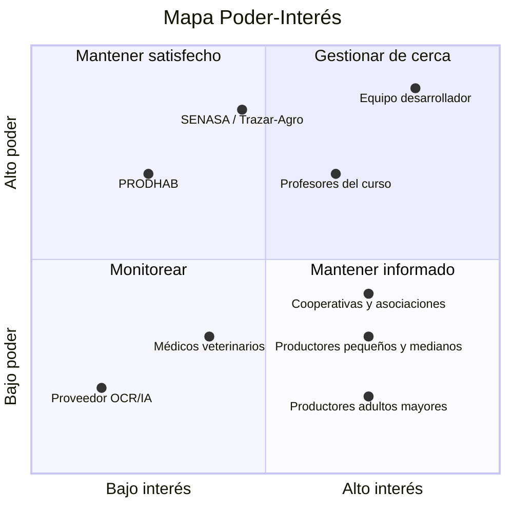
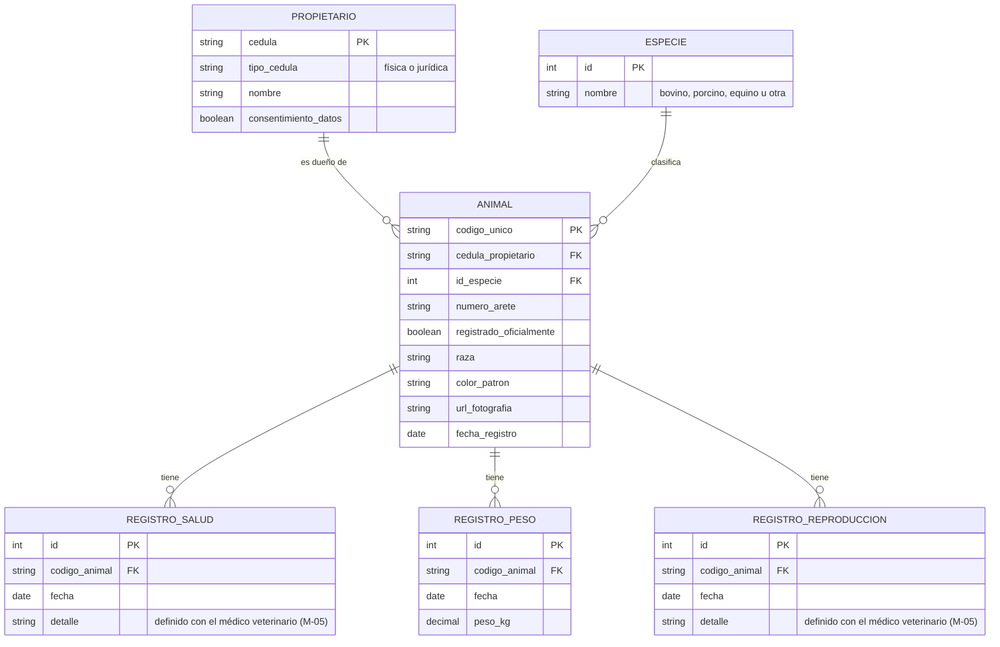

# Plataforma de Registro Individual de Ganado

## Sección 00 — Portada e identificación del equipo

**Proyecto final — ISW-912 · Administración de Proyectos Informáticos**

Universidad Técnica Nacional · Sede Regional de San Carlos · II Cuatrimestre 2026

**Estudiantes:** Marco López Quesada · Joseph Salazar Araya

**Profesores:** Yesenia Calvo Araya · Deiver Cubero Molina

**Versión del expediente:** 2.0 · noviembre de 2026

### Definición del Scrum Team

| Rol | Integrante | Responsabilidades principales |
|---|---|---|
| Product Owner | Marco López Quesada | Define y prioriza el Product Backlog; representa la visión del producto y las necesidades de los productores; decide qué se construye en cada Sprint. |
| Scrum Master | Joseph Salazar Araya | Facilita el proceso Scrum; da seguimiento al Sprint Backlog; elimina obstáculos del equipo; organiza Sprint Planning, Daily Scrum, Sprint Review y Retrospective. |
| Developer 1 | Developer 1 | Modelo de datos y registro individual: modelo multi-especie, propietario por cédula, ficha por animal y código único. |
| Developer 2 | Developer 2 | Módulo de asistencia por IA: lectura del arete mediante OCR y sugerencia de raza y color/patrón, con corrección manual. |
| Developer 3 | Developer 3 | Interfaz simple y validación: pasos guiados y mínima digitación, validados con productores reales o simulados. |

Duración del equipo: 14 semanas, correspondientes a la duración completa del curso.

---

## Sección 01 — Problema, oportunidad y Product Goal

### Acta de Inicio (Project Charter)

#### Justificación del proyecto

En Costa Rica, el sistema nacional de trazabilidad Trazar-Agro, del SENASA, se centra en la
identificación oficial de cada animal y en el control sanitario y de movilización, y en su
primera etapa cubre a bovinos y búfalos, según el Decreto Ejecutivo
N.° 44336-MAG-S-SP-MOPT (MAG, s. f.).
No ofrece a los productores —en particular a los pequeños y medianos, muchos de ellos adultos
mayores con poca familiaridad tecnológica— una herramienta de uso interno para administrar el
historial detallado de cada animal (salud, peso, reproducción, fotografías, propietario).
Además, el número de arete se digita a mano, lo que se presta a errores, y la conectividad en
las fincas rurales suele ser limitada.

El proyecto se justifica porque complementa, sin duplicar, el sistema oficial: ofrece a
los productores una plataforma propia para el control individual de su ganado, con una
interfaz simplificada y un módulo de inteligencia artificial que agiliza el registro
mediante fotografía (lectura del arete, sugerencia de raza y color/patrón), reduciendo el
tiempo y los errores de digitación, especialmente para usuarios con menor destreza
tecnológica.

#### Objetivo general

Desarrollar una plataforma digital que permita el registro y control individual detallado
del ganado en Costa Rica, organizado por categorías de especie y asociado a un propietario
mediante cédula, con generación automática de código único por animal y un módulo de IA
que agilice el registro mediante fotografía.

#### Objetivos específicos

1. Diseñar el modelo de datos multi-especie (bovinos, porcinos, equinos, etc.), incluyendo
   la entidad Propietario (cédula física o jurídica) vinculada a uno o varios animales,
   ficha detallada por animal, foto opcional y generación automática de código único.
2. Implementar un módulo de asistencia por IA que, a partir de la foto del animal,
   extraiga el número de arete mediante OCR cuando exista (usándolo como referencia si el
   animal ya está registrado oficialmente, o como base para iniciar su ficha si no lo
   está), y sugiera raza y color/patrón de pelaje como apoyo al llenado, con corrección
   manual en todos los casos.
3. Diseñar y validar una interfaz de uso simple (pasos guiados, mínima digitación) con
   productores reales o simulados, priorizando la accesibilidad para usuarios adultos
   mayores con poca experiencia en plataformas digitales.

#### Límites generales del proyecto

**Dentro del alcance**

- Registro y gestión de fichas individuales de ganado multi-especie (bovino, porcino,
  equino, etc.).
- Asociación de animales a un propietario mediante cédula física o jurídica.
- Generación automática de código único por animal.
- Módulo de IA/OCR para lectura de arete y sugerencia de raza/color-patrón a partir de
  fotografía.
- Interfaz simplificada orientada a productores con baja alfabetización digital.

**Fuera del alcance**

- Sustitución o duplicación del registro oficial de Trazar-Agro/SENASA.
- Procesos de pago, facturación o comercialización de ganado.
- Módulo veterinario avanzado (diagnósticos, historiales clínicos detallados) en esta
  fase.
- Soporte completamente offline; se asume conectividad intermitente, no ausencia total de
  red.

### Product Goal

Que el productor costarricense registre cada animal de su finca en pocos pasos, con su ficha
individual, su propietario y su código único, y que una fotografía le ahorre digitar el
arete, la raza y el color, como complemento del registro oficial.

---

## Sección 02 — Contexto organizacional y restricciones

### Lean Canvas

| Bloque | Contenido |
|---|---|
| Problema | Falta de una herramienta interna, simple y detallada para el control individual del ganado; Trazar-Agro cubre solo trazabilidad sanitaria/comercial; alta tasa de error en digitación manual del arete. |
| Segmentos de clientes | Productores pequeños y medianos; productores adultos mayores; propietarios con varias especies en una misma finca. |
| Propuesta de valor única | Control individual y detallado del ganado, con registro asistido por IA que reduce tiempo y errores de digitación, complementando el sistema nacional sin duplicarlo. |
| Solución | Plataforma multi-especie con ficha por animal, código único, asociación a propietario por cédula y módulo de IA/OCR para lectura de arete y sugerencia de raza/color-patrón. |
| Canales | Aplicación web/móvil; difusión a través de cooperativas y asociaciones de productores agropecuarios. |
| Flujos de ingreso | Proyecto académico, sin modelo de ingresos definido en esta etapa. |
| Estructura de costos | Tiempo de desarrollo de los dos estudiantes del equipo; hosting; costo de servicios de OCR/IA en la nube. |
| Métricas clave | Número de animales registrados; tasa de precisión del OCR; tasa de adopción en pruebas con usuarios reales o simulados. |
| Ventaja injusta | Diseño construido específicamente para el contexto costarricense (conectividad limitada, usuarios adultos mayores) e integración conceptual con Trazar-Agro/SENASA. |

### Factores Ambientales de la Empresa (EEF)

**Internos**

- Equipo de dos estudiantes que cubren las responsabilidades de Product Owner, Scrum
  Master y las líneas Developer 1 a 3.
- Tiempo disponible limitado al calendario académico de 14 semanas.
- Presupuesto estudiantil, dependiente de servicios gratuitos o de bajo costo (APIs de
  OCR, hosting).

**Externos**

- Normativa y sistema nacional Trazar-Agro / SENASA: cambios en sus políticas de datos o
  de acceso pueden afectar la integración planteada.
- Conectividad rural limitada en muchas fincas costarricenses.
- Perfil demográfico del usuario final (productores adultos mayores, baja alfabetización
  digital), que condiciona el diseño de la interfaz.
- Disponibilidad y costo de servicios de IA/OCR en la nube (dependencia de terceros).
- Ley N.° 8968 de Protección de la Persona frente al Tratamiento de sus Datos Personales,
  supervisada por la PRODHAB, que aplica a la cédula del propietario.

### Tipo de estructura organizacional

Orientada a proyectos. El equipo existe solo para este proyecto y no depende de una
organización funcional: el Product Owner decide el alcance y la prioridad, el Scrum Master
facilita el proceso sin autoridad jerárquica sobre los Developers y las decisiones técnicas
las toman los Developers (Sección 10). Esta estructura da al equipo control completo sobre
su tiempo y sus recursos, dentro de las restricciones del curso.

### Restricciones

- Equipo de dos estudiantes; trabajo acotado a las 14 semanas del curso.
- Presupuesto estudiantil, dependiente de servicios gratuitos o de bajo costo (APIs de
  OCR, hosting).
- Conectividad rural limitada en muchas fincas costarricenses.
- Perfil demográfico del usuario final (productores adultos mayores, baja alfabetización
  digital), que condiciona el diseño de la interfaz.

---

## Sección 03 — Interesados / stakeholders

### Registro de interesados

| Interesado | Rol / relación | Necesidad | Poder (1-5) | Interés (1-5) | Actitud | Estrategia | Responsable |
|---|---|---|---|---|---|---|---|
| Productores pequeños/medianos | Usuarios principales | Control simple y rápido de su ganado | 2 | 5 | Favorable | Informar y validar la interfaz con ellos | Marco López Quesada |
| Productores adultos mayores | Segmento crítico de usuarios | Interfaz sencilla, mínima digitación | 2 | 5 | Mixta | Involucrar en pruebas de usabilidad tempranas | Marco López Quesada |
| SENASA / Trazar-Agro | Entidad reguladora / sistema nacional | Que el proyecto no duplique ni interfiera con el registro oficial | 5 | 3 | Neutral | Mantener satisfecho; diseñar el producto como complemento del registro oficial | Joseph Salazar Araya |
| Equipo desarrollador | Responsables del proyecto | Cumplir los objetivos del curso y del producto | 5 | 5 | Favorable | Gestionar de cerca | Marco López Quesada y Joseph Salazar Araya |
| Profesores del curso (Yesenia Calvo Araya y Deiver Cubero Molina) | Evaluador / patrocinador académico | Evidencia de aplicación correcta de los conceptos del curso | 4 | 4 | Favorable | Gestionar de cerca con avances semanales | Joseph Salazar Araya |
| Proveedor de servicio OCR/IA | Tercero tecnológico | Uso correcto de su API/servicio | 2 | 2 | Neutral | Monitorear disponibilidad y costos | Joseph Salazar Araya |
| Cooperativas y asociaciones de productores | Canal de difusión entre productores | Que la herramienta sea útil para sus asociados y fácil de recomendar | 3 | 4 | Favorable | Mantener informado y consultar sobre la difusión | Marco López Quesada |
| Médicos veterinarios y asistentes técnicos | Usuarios secundarios; apoyo a los productores | Consultar con claridad los datos individuales de cada animal | 2 | 3 | Neutral | Monitorear y considerar su opinión sobre los datos de la ficha | Marco López Quesada |
| Agencia de Protección de Datos de los Habitantes (PRODHAB) | Entidad reguladora | Que el manejo de la cédula del propietario cumpla la normativa | 4 | 2 | Neutral | Mantener satisfecho; aplicar la normativa en el diseño de los datos | Joseph Salazar Araya |

### Justificación de las valoraciones discutibles

- **SENASA / Trazar-Agro (poder 5, interés 3):** su normativa y su sistema oficial pueden
  condicionar el diseño del producto, por eso el poder es alto; el interés es moderado
  porque la plataforma es una herramienta de uso interno del productor que complementa el
  sistema oficial y no sustituye ningún trámite.
- **Productores adultos mayores (poder 2, actitud mixta):** su poder de decisión sobre el
  proyecto es bajo, pero de su adopción depende el cumplimiento del tercer objetivo
  específico; la actitud es mixta por su poca familiaridad con plataformas digitales.
- **Cooperativas y asociaciones de productores (poder 3, interés 4):** no deciden el alcance
  del producto, pero pueden facilitar o dificultar su difusión entre los asociados.
- **PRODHAB (poder 4, interés 2):** puede exigir el
  cumplimiento de la normativa sobre la cédula del propietario, pero no sigue de cerca el
  avance del proyecto.

### Mapa Poder-Interés

Para ubicar a cada interesado, la escala de 1 a 5 se divide en bajo (1 a 3) y alto (4 a 5).

### Interesados críticos

| Interesado crítico | Por qué es crítico | Forma de involucramiento |
|---|---|---|
| Productores adultos mayores | De su adopción depende el cumplimiento del tercer objetivo específico y es el segmento con menor familiaridad tecnológica. | Pruebas de usabilidad tempranas del registro guiado con productores reales o simulados; sus observaciones se incorporan al Product Backlog y se revisan al cierre de cada Sprint. |
| SENASA / Trazar-Agro | Su normativa y su sistema oficial determinan que el producto sea un complemento y no un duplicado del registro oficial. | Consulta de su información pública al definir cada Sprint, para confirmar que el alcance complementa el registro oficial sin duplicarlo. |
| Profesores del curso | Evalúan cada entrega del Expediente, del repositorio y de la demostración. | Avance semanal del Expediente y del repositorio, y atención de su retroalimentación en el Sprint siguiente. |

---

## Sección 04 — Ciclo de vida del proyecto y primer Sprint

### Ciclo de vida del proyecto

El proyecto nace del problema descrito en la Sección 01: el sistema nacional Trazar-Agro
cubre el cumplimiento sanitario y comercial, pero los productores no cuentan con una
herramienta propia, detallada y fácil de usar para el control individual de cada animal.

La fecha de la entrega oficial del Expediente es fija (Semana 11, 25/11/2026) y el producto
se planifica de forma adaptativa en 5 Sprints de 2 semanas, del 12/10/2026 al 18/12/2026, por
lo que el ciclo de vida del proyecto es híbrido.

El trabajo avanza por tres líneas, tomadas de los objetivos específicos:

1. Modelo de datos y registro individual: modelo multi-especie, propietario por cédula,
   ficha por animal y código único.
2. Módulo de asistencia por IA: lectura del arete mediante OCR y sugerencia de raza y
   color/patrón, con corrección manual.
3. Interfaz simple y validación: pasos guiados y mínima digitación, validados con
   productores reales o simulados.

En la Semana 11 (25/11/2026) se entrega el Expediente completo, con la planificación del
release, y el equipo lo defiende ante los profesores del curso. El release planificado
termina con el Sprint 5, el 18/12/2026.

### Primer Sprint

**Duración:** 2 semanas, del 12/10/2026 al 23/10/2026 (Sprint 1 de 5).

**Sprint Goal:** Permitir al productor registrar un animal asociado a un propietario
identificado por cédula, con su código único generado automáticamente. Todo lo demás queda
para futuros Sprints.

**Historias que se atacan primero**

- HU-01 Registro de propietario por cédula.
- HU-02 Registro de animal asociado a un propietario.
- HU-03 Código único por animal.

**Por qué estas historias:** son la base de la que dependen las demás. Sin propietario y
animal registrados no hay a qué asociar la consulta de la ficha, la fotografía, la lectura
del arete ni las sugerencias del módulo de IA. El Sprint se limita a tres historias por el
tamaño del equipo.

---

## Sección 05 — Backlog inicial y Sprint Backlog

### Backlog inicial

El backlog está ordenado por valor para el productor y por dependencia entre historias.

| ID | Historia de usuario | Prioridad |
|---|---|---|
| HU-01 | Como productor, quiero registrar a un propietario por su cédula física o jurídica para asociarle sus animales. | Alta |
| HU-02 | Como productor, quiero registrar un animal en su categoría de especie, asociado a un propietario, para llevar su control individual. | Alta |
| HU-03 | Como productor, quiero que cada animal reciba un código único generado automáticamente para identificarlo sin duplicados. | Alta |
| HU-04 | Como productor, quiero consultar la ficha de un animal registrado para ver sus datos. | Alta |
| HU-05 | Como productor, quiero administrar varios animales de un mismo propietario desde la ficha del propietario. | Media |
| HU-06 | Como productor, quiero completar la ficha detallada del animal con su salud, peso y reproducción. | Media |
| HU-07 | Como productor, quiero adjuntar una fotografía opcional del animal. | Alta |
| HU-08 | Como productor, quiero que la plataforma lea el número de arete a partir de la fotografía (OCR) para reducir errores de digitación. | Alta |
| HU-09 | Como productor, quiero recibir sugerencias de raza y de color/patrón de pelaje a partir de la fotografía para completar la ficha con menos esfuerzo. | Media |
| HU-10 | Como productor, quiero corregir manualmente los datos sugeridos por el módulo de IA. | Media |
| HU-11 | Como productor, quiero registrar un animal mediante pasos guiados y con mínima digitación. | Alta |
| HU-12 | Como productor, quiero indicar si el animal ya está registrado oficialmente para que su número de arete se use como referencia y complementar su ficha sin duplicar el registro oficial. | Media |

### Sprint Backlog

#### Sprint 1 (12/10/2026 al 23/10/2026)

**Sprint Goal:** Permitir al productor registrar un animal asociado a un propietario
identificado por cédula, con su código único generado automáticamente.

| Historia | Plan de entrega |
|---|---|
| HU-01 | Definir los datos del propietario (cédula física o jurídica) y su registro. |
| HU-02 | Definir la ficha del animal por categoría de especie y su registro asociado a un propietario. |
| HU-03 | Definir la regla de generación automática del código único. |

**Tareas del Sprint 1:**

| Historia | Tarea | Responsable |
|---|---|---|
| HU-01 | RIG-2 Montar la estructura del proyecto y la base de datos | Developer 1 |
| HU-01 | RIG-3 Modelar la tabla de propietarios (cédula física y jurídica) | Developer 1 |
| HU-01 | RIG-4 Implementar el registro de propietario y bloquear cédulas duplicadas | Developer 1 |
| HU-01 | RIG-5 Verificar criterios de aceptación y Definition of Done | Joseph Salazar Araya |
| HU-02 | RIG-7 Modelar la entidad animal y sus categorías de especie | Developer 1 |
| HU-02 | RIG-8 Implementar el registro del animal asociado a un propietario | Developer 1 |
| HU-02 | RIG-9 Validar que la especie y el propietario sean obligatorios | Developer 1 |
| HU-02 | RIG-10 Verificar criterios de aceptación y Definition of Done | Joseph Salazar Araya |
| HU-03 | RIG-12 Definir la regla de generación del código único | Developer 1 |
| HU-03 | RIG-13 Generar el código automáticamente al guardar el animal y garantizar que no se repita | Developer 1 |
| HU-03 | RIG-14 Verificar criterios de aceptación y Definition of Done | Joseph Salazar Araya |

**Acciones de mitigación (Sección 08):**

| Acción | Riesgo | Responsable | Jira |
|---|---|---|---|
| M-04 Confirmar la capacidad del equipo en cada Sprint Planning y ajustar el Sprint Backlog. | R-05 | Joseph Salazar Araya (Scrum Master) | RIG-65 |
| M-08 Agregar aviso de consentimiento en el registro del propietario y usar solo cédulas ficticias. | R-07 | Developer 1 | RIG-69 |

#### Sprint 2 (26/10/2026 al 06/11/2026)

**Sprint Goal:** Permitir al productor consultar la ficha de un animal, ver todos los animales
de un propietario, adjuntar una fotografía opcional y registrar un animal mediante pasos
guiados con mínima digitación.

| Historia | Plan de entrega |
|---|---|
| HU-04 | Mostrar en la ficha del animal su código único, su especie y su propietario. |
| HU-05 | Mostrar la lista de animales de cada propietario y agregar a ella los animales nuevos. |
| HU-07 | Permitir adjuntar una fotografía opcional al registrar el animal, guardarla y mostrarla en la ficha. |
| HU-11 | Organizar el registro del animal en pasos guiados, reemplazar la digitación por listas de selección en los datos con opciones definidas y validarlo con 3 productores reales o simulados. |

**Acciones de mitigación (Sección 08):**

| Acción | Riesgo | Responsable | Jira |
|---|---|---|---|
| M-01 Probar el servicio de OCR con al menos 20 fotografías reales de aretes antes de integrarlo en HU-08. | R-01 | Developer 2 | RIG-62 |
| M-06 Comprimir la fotografía antes de subirla y reintentar la carga cuando falle la conexión. | R-09 | Developer 1 | RIG-67 |
| M-10 Revisar el consumo y los límites gratuitos de hosting, base de datos y almacenamiento de imágenes. | R-04 | Marco López Quesada | RIG-71 |

#### Sprint 3 (09/11/2026 al 20/11/2026)

**Sprint Goal:** Permitir al productor obtener el número de arete leído automáticamente a
partir de la fotografía y registrar el peso del animal en su ficha.

| Historia | Plan de entrega |
|---|---|
| HU-08 | Integrar el servicio de OCR para sugerir el número de arete a partir de la fotografía y permitir el ingreso manual cuando no se detecta. |
| HU-06b | Guardar los datos de peso en la ficha y mostrarlos junto con los datos básicos del animal. |

**Acciones de mitigación (Sección 08):**

| Acción | Riesgo | Responsable | Jira |
|---|---|---|---|
| M-02 Probar por especie la sugerencia de raza y color/patrón con fotos de bovinos, porcinos y equinos antes de integrarla en HU-09a y HU-09b. | R-02 | Developer 2 | RIG-63 |
| M-03 Encapsular el OCR y la IA detrás de una interfaz propia y configurar alertas de cuota. | R-03 | Developer 2 | RIG-64 |

#### Sprint 4 (23/11/2026 al 04/12/2026)

**Sprint Goal:** Permitir al productor recibir sugerencias de raza y de color/patrón de
pelaje a partir de la fotografía del animal.

| Historia | Plan de entrega |
|---|---|
| HU-09a | Proponer una raza a partir de la fotografía y permitir completarla manualmente cuando el sistema no logra proponerla. |
| HU-09b | Proponer un color/patrón de pelaje a partir de la fotografía y permitir completarlo manualmente cuando el sistema no logra proponerlo. |

**Acciones de mitigación (Sección 08):**

| Acción | Riesgo | Responsable | Jira |
|---|---|---|---|
| M-05 Definir con un médico veterinario los datos de HU-06a y HU-06c antes del Sprint Planning 5. | R-10 | Marco López Quesada (Product Owner) | RIG-66 |
| M-09 Revisar la información pública de SENASA/Trazar-Agro sobre el formato del arete antes de HU-12. | R-08 | Joseph Salazar Araya | RIG-70 |

#### Sprint 5 (07/12/2026 al 18/12/2026)

**Sprint Goal:** Permitir al productor completar los datos de salud y reproducción del
animal, corregir los datos sugeridos por el módulo de IA y usar el número de arete como
referencia del registro oficial.

| Historia | Plan de entrega |
|---|---|
| HU-10 | Mostrar como editables los datos sugeridos por el módulo de IA y guardar el valor corregido o confirmado. |
| HU-12 | Guardar el número de arete como referencia de la ficha y registrar si el productor indica que el animal ya está registrado oficialmente, sin duplicar ni modificar el registro oficial. |
| HU-06a | Definir los datos de salud, guardarlos en la ficha y mostrarlos junto con los datos básicos del animal. |
| HU-06c | Definir los datos de reproducción, guardarlos en la ficha y mostrarlos junto con los datos básicos del animal. |

**Acciones de mitigación (Sección 08):**

| Acción | Riesgo | Responsable | Jira |
|---|---|---|---|
| M-07 Repetir la prueba de usabilidad con el registro completo, ya con el módulo de IA, con al menos 3 productores reales o simulados. | R-06 | Developer 3 | RIG-68 |

### Mecanismo de seguimiento

El Sprint Backlog se sigue en el proyecto de Jira **RIG — Plataforma de Registro Individual
de Ganado**, con un Sprint de Jira por cada Sprint del plan. El tablero se actualiza en cada
Daily Scrum. El Scrum Master organiza el Daily Scrum y da seguimiento al Sprint Backlog.

#### Tablero de Trabajo

- Tablero del Sprint: https://marcolopezquesada15.atlassian.net/jira/software/projects/RIG/boards/69
- Backlog y Sprints: https://marcolopezquesada15.atlassian.net/jira/software/projects/RIG/boards/69/backlog

Sprints registrados en Jira:

| Sprint | Fechas | Historias | Elementos en Jira |
|---|---|---|---|
| Sprint 1 | 12/10/2026 al 23/10/2026 | HU-01, HU-02, HU-03 | RIG-1, RIG-6, RIG-11 |
| Sprint 2 | 26/10/2026 al 06/11/2026 | HU-04, HU-05, HU-07, HU-11 | RIG-15, RIG-29, RIG-19, RIG-24 |
| Sprint 3 | 09/11/2026 al 20/11/2026 | HU-08, HU-06b | RIG-33, RIG-72 |
| Sprint 4 | 23/11/2026 al 04/12/2026 | HU-09a, HU-09b | RIG-39, RIG-44 |
| Sprint 5 | 07/12/2026 al 18/12/2026 | HU-10, HU-12, HU-06a, HU-06c | RIG-53, RIG-57, RIG-48, RIG-76 |

Cada historia de usuario es una *Historia* de Jira que lleva su enunciado, sus criterios de
aceptación, su estimación en puntos, su prioridad, su línea de trabajo (etiqueta) y sus
dependencias, registradas como vínculos *bloquea / está bloqueada por*. Cada historia se
convierte en **tareas (subtareas de Jira)** asignadas al integrante del Scrum Team que las
desarrolla; la última tarea de cada historia es *Verificar criterios de aceptación y
Definition of Done* y se asigna al estudiante que no construyó la historia. Las acciones de
mitigación de la Sección 08 se registran como tareas con la etiqueta `riesgo`.

| Columna | Significado | Límite WIP | Justificación |
|---|---|---|---|
| Por hacer (To Do) | Historias y tareas del Sprint Backlog que todavía no se empiezan. | Sin límite | Es el Sprint Backlog del Sprint en curso. |
| En progreso (In Progress) | Historias que un estudiante está construyendo. | 2 | El equipo son dos estudiantes: una historia activa por estudiante. Con más historias abiertas el trabajo se dispersa y ninguna termina. |
| En revisión (In Review) | Historias construidas que el estudiante que no las construyó verifica contra sus criterios de aceptación y la Definition of Done. | 2 | Cada estudiante revisa las historias del otro: con más de dos historias pendientes de revisión, la revisión se vuelve el cuello de botella. |
| Hecho (Done) | Historias que cumplen la Definition of Done (Sección 09). | Sin límite | Solo lo terminado según la Definition of Done cuenta para la velocidad. |

Los límites WIP aplican a las historias. Las acciones de mitigación (etiqueta `riesgo`) se
siguen en el mismo tablero, pero no cuentan para el límite.

**Impedimentos:** una historia o tarea detenida por un impedimento se marca con la bandera
de impedimento (*Flagged*) de Jira, lo que la resalta en el tablero para escalarla según la
Sección 10.

**Responsable por tarea:** cada tarea tiene asignado como responsable al integrante del
Scrum Team que la desarrolla.

**Regla para mover una historia a Hecho:** una historia pasa a Hecho cuando todas sus tareas
están en Hecho, incluida la verificación de sus criterios de aceptación por el estudiante que no
la construyó, y cumple la Definition of Done de la Sección 09.
La verificación queda registrada como comentario en la tarea de verificación de la
historia en Jira.

---

## Sección 06 — Alcance, Product Backlog priorizado y criterios de aceptación

### Declaración de alcance

**Alcance del producto:**

| Dentro del alcance | Fuera del alcance |
|---|---|
| Registro y ficha individual de ganado multi-especie (bovino, porcino, equino y otras) | Sustitución o duplicación del registro oficial de Trazar-Agro/SENASA |
| Asociación de cada animal a un propietario por cédula física o jurídica | Pagos, facturación o comercialización de ganado |
| Código único por animal generado automáticamente | Módulo veterinario avanzado (diagnósticos e historiales clínicos detallados) |
| Lectura del arete (OCR) y sugerencia de raza y color/patrón a partir de fotografía, con corrección manual | Conexión directa con los sistemas de Trazar-Agro/SENASA |
| Interfaz guiada para productores con baja alfabetización digital | Inicio de sesión, gestión de usuarios y funcionamiento completamente sin conexión |

**Alcance del proyecto:** el trabajo necesario para lograr el producto: las 15 historias del
Product Backlog, las acciones de mitigación M-01 a M-10, dos pruebas de usabilidad con
productores y el Expediente del Proyecto.

### Product Backlog priorizado

El orden refleja el valor para el productor y las dependencias entre historias, y coincide
con el orden de los Sprints. Prioridad Alta: sin ella no hay un registro usable. Media:
completa el valor del producto. Baja: es lo primero que sale del release si falta capacidad.
La estimación se expresa en puntos de historia (secuencia de Fibonacci).

| Orden | ID | Historia | Prioridad | Estimación (puntos) | Sprint | Objetivo específico |
|---|---|---|---|---|---|---|
| 1 | HU-01 | Registro de propietario por cédula | Alta | 3 | 1 | 1 |
| 2 | HU-02 | Registro de animal asociado a un propietario | Alta | 5 | 1 | 1 |
| 3 | HU-03 | Código único por animal | Alta | 2 | 1 | 1 |
| 4 | HU-04 | Consulta de la ficha del animal | Alta | 2 | 2 | 1 |
| 5 | HU-05 | Varios animales por propietario | Media | 2 | 2 | 1 |
| 6 | HU-07 | Fotografía opcional del animal | Alta | 3 | 2 | 1 |
| 7 | HU-11 | Registro guiado con mínima digitación | Alta | 5 | 2 | 3 |
| 8 | HU-08 | Lectura del número de arete (OCR) | Alta | 8 | 3 | 2 |
| 9 | HU-06b | Datos de peso en la ficha del animal | Media | 2 | 3 | 1 |
| 10 | HU-09a | Sugerencia de raza | Media | 8 | 4 | 2 |
| 11 | HU-09b | Sugerencia de color/patrón de pelaje | Media | 5 | 4 | 2 |
| 12 | HU-10 | Corrección manual de lo sugerido por la IA | Media | 2 | 5 | 2 |
| 13 | HU-12 | Arete como referencia del registro oficial | Media | 5 | 5 | 1 y 2 |
| 14 | HU-06a | Datos de salud en la ficha del animal | Baja | 3 | 5 | 1 |
| 15 | HU-06c | Datos de reproducción en la ficha del animal | Baja | 3 | 5 | 1 |

### Criterios de aceptación

#### HU-01 — Registro de propietario por cédula

| Campo | Detalle |
|---|---|
| Como | Productor |
| Quiero | Registrar a un propietario por su cédula física o jurídica |
| Para | Asociarle sus animales |
| Criterios de aceptación | 1. *Dado que* el productor digita una cédula física, *cuando* confirma el registro, *entonces* el sistema registra al propietario identificado con esa cédula. 2. *Dado que* el productor digita una cédula jurídica, *cuando* confirma el registro, *entonces* el sistema registra al propietario identificado con esa cédula. 3. *Dado que* la cédula ya está registrada, *cuando* el productor intenta registrarla de nuevo, *entonces* el sistema no crea un segundo propietario con la misma cédula. |
| Prioridad | Alta |
| Estimación | 3 puntos |
| Notas | Sin dependencias previas. Es la base del registro: sin propietario registrado no se pueden asociar animales (HU-02). La cédula es un dato personal, sujeto a la normativa de protección de datos identificada en las Secciones 02 y 03. |

#### HU-02 — Registro de animal asociado a un propietario

| Campo | Detalle |
|---|---|
| Como | Productor |
| Quiero | Registrar un animal en su categoría de especie, asociado a un propietario |
| Para | Llevar su control individual |
| Criterios de aceptación | 1. *Dado que* existe un propietario registrado, *cuando* el productor registra un animal indicando su categoría de especie (bovino, porcino, equino u otra), *entonces* el animal queda registrado en esa categoría y asociado a ese propietario. 2. *Dado que* el productor no indicó la categoría de especie o el propietario, *cuando* confirma el registro, *entonces* el sistema no registra el animal. 3. *Dado que* el propietario ya tiene animales registrados, *cuando* el productor registra otro animal para él, *entonces* el nuevo animal queda asociado al mismo propietario. |
| Prioridad | Alta |
| Estimación | 5 puntos |
| Notas | Depende de HU-01. Al registrarse, el animal recibe su código único generado automáticamente (HU-03, Objetivo específico 1). |

#### HU-03 — Código único por animal

| Campo | Detalle |
|---|---|
| Como | Productor |
| Quiero | Que cada animal reciba un código único generado automáticamente |
| Para | Identificarlo sin duplicados |
| Criterios de aceptación | 1. *Dado que* se registra un animal, *cuando* se guarda, *entonces* el sistema le asigna un código único generado automáticamente. 2. *Dado que* ya existen animales con código asignado, *cuando* se registra otro animal, *entonces* su código es distinto de todos los existentes. |
| Prioridad | Alta |
| Estimación | 2 puntos |
| Notas | Depende de HU-02. |

#### HU-04 — Consulta de la ficha del animal

| Campo | Detalle |
|---|---|
| Como | Productor |
| Quiero | Consultar la ficha de un animal registrado |
| Para | Ver sus datos |
| Criterios de aceptación | 1. *Dado que* el animal está registrado, *cuando* el productor consulta su ficha, *entonces* el sistema muestra su código único, su especie y su propietario. |
| Prioridad | Alta |
| Estimación | 2 puntos |
| Notas | Depende de HU-02 y HU-03. |

#### HU-05 — Varios animales por propietario

| Campo | Detalle |
|---|---|
| Como | Productor |
| Quiero | Administrar varios animales de un mismo propietario desde la ficha del propietario |
| Para | Llevar el control de todo su ganado en un solo lugar |
| Criterios de aceptación | 1. *Dado que* un propietario tiene animales registrados, *cuando* el productor consulta a ese propietario, *entonces* el sistema muestra la lista de todos sus animales. 2. *Dado que* el productor registra otro animal para el mismo propietario, *cuando* lo guarda, *entonces* el animal aparece en la lista junto con los anteriores. |
| Prioridad | Media |
| Estimación | 2 puntos |
| Notas | Depende de HU-01 y HU-02. |

#### HU-06a — Datos de salud en la ficha del animal

| Campo | Detalle |
|---|---|
| Como | Productor |
| Quiero | Completar los datos de salud en la ficha del animal |
| Para | Llevar el historial de cada animal |
| Criterios de aceptación | 1. *Dado que* el animal está registrado, *cuando* el productor completa datos de salud y guarda, *entonces* la ficha conserva esos datos. 2. *Dado que* la ficha tiene datos de salud, *cuando* el productor la consulta, *entonces* el sistema los muestra junto con los datos básicos del animal. |
| Prioridad | Baja |
| Estimación | 3 puntos |
| Notas | Depende de HU-02. Proviene de la división de HU-06. Los datos concretos de salud se definen con un médico veterinario (M-05). |

#### HU-06b — Datos de peso en la ficha del animal

| Campo | Detalle |
|---|---|
| Como | Productor |
| Quiero | Completar los datos de peso en la ficha del animal |
| Para | Llevar el historial de cada animal |
| Criterios de aceptación | 1. *Dado que* el animal está registrado, *cuando* el productor completa datos de peso y guarda, *entonces* la ficha conserva esos datos. 2. *Dado que* la ficha tiene datos de peso, *cuando* el productor la consulta, *entonces* el sistema los muestra junto con los datos básicos del animal. |
| Prioridad | Media |
| Estimación | 2 puntos |
| Notas | Depende de HU-02. Proviene de la división de HU-06. |

#### HU-06c — Datos de reproducción en la ficha del animal

| Campo | Detalle |
|---|---|
| Como | Productor |
| Quiero | Completar los datos de reproducción en la ficha del animal |
| Para | Llevar el historial de cada animal |
| Criterios de aceptación | 1. *Dado que* el animal está registrado, *cuando* el productor completa datos de reproducción y guarda, *entonces* la ficha conserva esos datos. 2. *Dado que* la ficha tiene datos de reproducción, *cuando* el productor la consulta, *entonces* el sistema los muestra junto con los datos básicos del animal. |
| Prioridad | Baja |
| Estimación | 3 puntos |
| Notas | Depende de HU-02. Proviene de la división de HU-06. Los datos concretos de reproducción se definen con un médico veterinario (M-05). |

#### HU-07 — Fotografía opcional del animal

| Campo | Detalle |
|---|---|
| Como | Productor |
| Quiero | Adjuntar una fotografía opcional del animal |
| Para | Identificarlo visualmente en su ficha |
| Criterios de aceptación | 1. *Dado que* el productor registra un animal, *cuando* no adjunta fotografía, *entonces* el registro se completa sin ella. 2. *Dado que* el productor adjunta una fotografía, *cuando* guarda el registro, *entonces* la fotografía queda asociada a la ficha y se muestra al consultarla. |
| Prioridad | Alta |
| Estimación | 3 puntos |
| Notas | Depende de HU-02. |

#### HU-08 — Lectura del número de arete (OCR)

| Campo | Detalle |
|---|---|
| Como | Productor |
| Quiero | Que la plataforma lea el número de arete a partir de la fotografía (OCR) |
| Para | Reducir errores de digitación |
| Criterios de aceptación | 1. *Dado que* la fotografía muestra un arete legible, *cuando* el productor solicita la lectura, *entonces* el sistema sugiere el número de arete detectado. 2. *Dado que* el sistema no logra leer el arete, *cuando* termina el proceso, *entonces* informa que no se detectó el número y permite ingresarlo manualmente. 3. *Dado que* se prueba la lectura con al menos 20 fotografías de aretes legibles, *cuando* termina la prueba, *entonces* el número leído es correcto en al menos el 70 % de ellas. |
| Prioridad | Alta |
| Estimación | 8 puntos |
| Notas | Depende de HU-07. El servicio se prueba antes de integrarlo (M-01). |

#### HU-09a — Sugerencia de raza

| Campo | Detalle |
|---|---|
| Como | Productor |
| Quiero | Recibir una sugerencia de raza a partir de la fotografía |
| Para | Completar la ficha con menos esfuerzo |
| Criterios de aceptación | 1. *Dado que* el animal tiene fotografía, *cuando* el productor solicita la sugerencia, *entonces* el sistema propone una raza como apoyo al llenado de la ficha. 2. *Dado que* el sistema no logra proponer una raza, *cuando* termina el proceso, *entonces* el productor puede completarla manualmente. |
| Prioridad | Media |
| Estimación | 8 puntos |
| Notas | Depende de HU-07. Proviene de la división de HU-09. |

#### HU-09b — Sugerencia de color/patrón de pelaje

| Campo | Detalle |
|---|---|
| Como | Productor |
| Quiero | Recibir una sugerencia de color/patrón de pelaje a partir de la fotografía |
| Para | Completar la ficha con menos esfuerzo |
| Criterios de aceptación | 1. *Dado que* el animal tiene fotografía, *cuando* el productor solicita la sugerencia, *entonces* el sistema propone un color/patrón de pelaje como apoyo al llenado de la ficha. 2. *Dado que* el sistema no logra proponer un color/patrón, *cuando* termina el proceso, *entonces* el productor puede completarlo manualmente. |
| Prioridad | Media |
| Estimación | 5 puntos |
| Notas | Depende de HU-07. Proviene de la división de HU-09. |

#### HU-10 — Corrección manual de lo sugerido por la IA

| Campo | Detalle |
|---|---|
| Como | Productor |
| Quiero | Corregir manualmente los datos sugeridos por el módulo de IA |
| Para | Asegurar que los datos de la ficha sean correctos |
| Criterios de aceptación | 1. *Dado que* el módulo de IA sugirió el número de arete, la raza o el color/patrón, *cuando* el productor modifica cualquiera de esos valores, *entonces* la ficha guarda el valor corregido y no la sugerencia. 2. *Dado que* el módulo de IA sugirió valores, *cuando* el productor los confirma, *entonces* la ficha guarda los valores confirmados. |
| Prioridad | Media |
| Estimación | 2 puntos |
| Notas | Depende de HU-08, HU-09a y HU-09b. |

#### HU-11 — Registro guiado con mínima digitación

| Campo | Detalle |
|---|---|
| Como | Productor |
| Quiero | Registrar un animal mediante pasos guiados y con mínima digitación |
| Para | Hacerlo sin dificultad aunque tenga poca experiencia con plataformas digitales |
| Criterios de aceptación | 1. *Dado que* el productor inicia el registro de un animal, *cuando* avanza en el proceso, *entonces* el sistema lo conduce por pasos guiados. 2. *Dado que* un dato tiene opciones definidas, como la categoría de especie, *cuando* el productor lo completa, *entonces* lo selecciona de una lista en lugar de digitarlo. 3. *Dado que* 3 productores reales o simulados, al menos uno adulto mayor, prueban el registro guiado, *cuando* registran un propietario y un animal, *entonces* cada uno lo completa sin ayuda en menos de 5 minutos. |
| Prioridad | Alta |
| Estimación | 5 puntos |
| Notas | Depende de HU-02. La prueba se describe en la estrategia de validación (Sección 09). |

#### HU-12 — Arete como referencia del registro oficial

| Campo | Detalle |
|---|---|
| Como | Productor |
| Quiero | Indicar si el animal ya está registrado oficialmente para que su número de arete se use como referencia |
| Para | Complementar su ficha sin duplicar el registro oficial |
| Criterios de aceptación | 1. *Dado que* el productor indica que el animal ya está registrado oficialmente, *cuando* guarda la ficha con su número de arete, *entonces* el número se guarda como referencia del registro oficial. 2. *Dado que* el productor indica que el animal no está registrado oficialmente, *cuando* guarda la ficha con su número de arete, *entonces* el número sirve de base para iniciar la ficha. 3. *Dado que* se guarda la ficha, *cuando* termina el registro, *entonces* la plataforma no envía ni modifica datos en Trazar-Agro/SENASA. |
| Prioridad | Media |
| Estimación | 5 puntos |
| Notas | Depende de HU-02 y HU-08. |

---

## Sección 07 — Planificación temporal, estimaciones y costos

### Plan temporal

El proyecto sigue el calendario académico del II Cuatrimestre 2026. El producto se planifica
en 5 Sprints de 2 semanas, del 12/10/2026 al 18/12/2026. El Expediente completo se entrega y
se defiende en la Semana 11 (25/11/2026), durante el Sprint 4.

**Hitos:** inicio del Sprint 1 (12/10/2026); primera prueba de usabilidad del registro guiado
(Sprint 2, HU-11); entrega y defensa del Expediente (25/11/2026); segunda prueba de
usabilidad (Sprint 5, M-07); cierre del release en la Sprint Review del Sprint 5 (18/12/2026).

**Dependencias que condicionan el orden:** HU-01 → HU-02 → HU-03, HU-04 y HU-05;
HU-02 → HU-07 → HU-08 → HU-09a y HU-09b → HU-10; HU-08 → HU-12.

**Control del avance:** al cierre de cada Sprint se registran en el burndown del release los
puntos pendientes reales y se comparan con el plan. Las fechas solo cambian por decisiones
registradas en Jira y en la Sección 11.

### Estimaciones

#### Técnica y escala

Las historias de usuario se estiman con planning poker, en puntos de historia con la
secuencia de Fibonacci. Un punto mide el tamaño relativo de la historia (esfuerzo,
complejidad e incertidumbre), no horas. La historia de referencia es HU-01 (3 puntos) y
cada historia se compara con ella.

| Puntos | Tamaño | Uso |
|---|---|---|
| 1 | Trivial | Cambio mínimo, sin riesgo |
| 2 | Pequeña | Tarea simple y conocida |
| 3 | Mediana | Historia de referencia del equipo |
| 5 | Grande | Más partes que conectar o probar |
| 8 | Muy grande | Mucha complejidad o incertidumbre |
| 13 | Dividir | Esconde varias historias |

#### Matriz de estimación

| ID | Historia | Puntos | Prioridad | Dependencias | Justificación |
|---|---|---|---|---|---|
| HU-01 | Registro de propietario por cédula | 3 | Alta | Ninguna | Historia de referencia. Acepta dos tipos de cédula y no permite duplicar propietarios; incluye montar la base de datos y la estructura del proyecto, lo que pesa para un equipo junior. |
| HU-02 | Registro de animal asociado a un propietario | 5 | Alta | HU-01 | Más grande que HU-01 sin llegar al doble: depende del propietario, maneja las categorías de especie, valida que no falten la especie ni el propietario y asocia varios animales a una cédula. No lleva IA, fotografías ni tecnología desconocida. |
| HU-03 | Código único por animal | 2 | Alta | HU-02 | Una sola regla: generar el código al guardar el animal y garantizar que no se repita. Menor que HU-01 porque no monta estructura nueva. |
| HU-04 | Consulta de la ficha del animal | 2 | Alta | HU-02, HU-03 | Muestra datos ya registrados (código, especie y propietario); no valida ni guarda información. |
| HU-05 | Varios animales por propietario | 2 | Media | HU-01, HU-02 | La asociación entre animal y propietario ya existe desde HU-02; se agrega la lista de animales del propietario. |
| HU-06a | Datos de salud en la ficha del animal | 3 | Baja | HU-02 | Igual que HU-01: un grupo de datos que se guarda y se muestra, con incertidumbre sobre los datos concretos de salud, que se definen con un médico veterinario. |
| HU-06b | Datos de peso en la ficha del animal | 2 | Media | HU-02 | Menor que HU-06a: un solo dato conocido, el peso, sin incertidumbre sobre qué registrar. |
| HU-06c | Datos de reproducción en la ficha del animal | 3 | Baja | HU-02 | Igual que HU-06a: un grupo de datos con incertidumbre sobre los datos concretos de reproducción. |
| HU-07 | Fotografía opcional del animal | 3 | Alta | HU-02 | Similar a HU-01: además de guardar, maneja la carga y el almacenamiento de imágenes, algo nuevo para el equipo. |
| HU-08 | Lectura del número de arete (OCR) | 8 | Alta | HU-07 | Integra un servicio de OCR desconocido para el equipo, depende de la calidad de la fotografía y debe manejar el caso en que el arete no se lee. |
| HU-09a | Sugerencia de raza | 8 | Media | HU-07 | Integra por primera vez un servicio de IA desconocido para el equipo y debe reconocer razas de varias especies. |
| HU-09b | Sugerencia de color/patrón de pelaje | 5 | Media | HU-07 | Usa el mismo servicio de IA que HU-09a, con menos incertidumbre que la raza. |
| HU-10 | Corrección manual de lo sugerido por la IA | 2 | Media | HU-08, HU-09a, HU-09b | Los campos sugeridos se muestran editables antes de guardar; reutiliza el registro existente. |
| HU-11 | Registro guiado con mínima digitación | 5 | Alta | HU-02 | Reorganiza todo el registro en pasos y listas de selección, y requiere ajustes después de validar con productores. |
| HU-12 | Arete como referencia del registro oficial | 5 | Media | HU-02, HU-08 | Guarda el arete como referencia y registra si el productor indica que el animal está registrado oficialmente, sin duplicar ni modificar el registro oficial; hay incertidumbre en el formato del arete que usa Trazar-Agro. |

**Total del Product Backlog:** 58 puntos.

#### Desglose por línea de trabajo

| Línea de trabajo | Objetivo específico | Historias | Puntos |
|---|---|---|---|
| Modelo de datos y registro individual | 1 | HU-01, HU-02, HU-03, HU-04, HU-05, HU-06a, HU-06b, HU-06c, HU-07, HU-12 | 30 |
| Módulo de asistencia por IA | 2 | HU-08, HU-09a, HU-09b, HU-10 | 23 |
| Interfaz simple y validación | 3 | HU-11 | 5 |
| Total | | | 58 |

#### Historias para dividir

| Historia | Puntos | División |
|---|---|---|
| HU-09 | 13 | HU-09a (8): sugerencia de raza a partir de la fotografía. HU-09b (5): sugerencia de color/patrón de pelaje a partir de la fotografía. |
| HU-06 | 8 | HU-06a (3): datos de salud. HU-06b (2): datos de peso. HU-06c (3): datos de reproducción. |

#### Supuestos y riesgos de la estimación

- El OCR y la IA se consumen como servicios externos; si se requiere entrenar un modelo
  propio, HU-08, HU-09a y HU-09b se reestiman.
- HU-05 no incluye inicio de sesión ni gestión de usuarios.
- HU-12 no incluye conexión directa con los sistemas de Trazar-Agro/SENASA.
- Los datos concretos de salud, peso y reproducción de HU-06a, HU-06b y HU-06c se definen
  antes del Sprint en que se desarrollen; si son más de los previstos, se reestiman.
- El equipo es junior: las primeras historias cargan con la curva de aprendizaje de las
  herramientas.

### Cronograma de entregas

**Duración del Sprint:** 2 semanas. **Inicio del Sprint 1:** lunes 12/10/2026. **Fin del
Sprint 5:** viernes 18/12/2026.

**Velocidad inicial:** 12 puntos por Sprint, acordada en planning poker a partir de la
capacidad del equipo, con un rango esperado de 10 a 13 puntos. Se actualiza al cierre de cada
Sprint con los puntos de las historias que quedan en Hecho y cumplen la Definition of Done.
Las acciones de mitigación no llevan puntos: no cuentan para la velocidad, pero sí consumen
capacidad del Sprint.

#### Sprints necesarios

| Velocidad | Puntos por Sprint | Cálculo | Sprints |
|---|---|---|---|
| Mínima | 10 | 58 ÷ 10 = 5,8 | 6 |
| Inicial | 12 | 58 ÷ 12 = 4,8 | 5 |
| Máxima | 13 | 58 ÷ 13 = 4,5 | 5 |

El release necesita entre 5 y 6 Sprints. El plazo se fija en 5 Sprints: si la velocidad real
queda en 10 puntos, el Product Owner devuelve al Product Backlog primero HU-06c y luego HU-06a,
las historias de menor prioridad (contingencia de R-05).

#### Incremento por Sprint

| Sprint | Fechas | Historias | Puntos | Incremento |
|---|---|---|---|---|
| 1 | 12/10/2026 al 23/10/2026 | HU-01, HU-02, HU-03 | 10 | El productor registra un propietario por su cédula y un animal asociado a él, con su código único generado automáticamente. |
| 2 | 26/10/2026 al 06/11/2026 | HU-04, HU-05, HU-07, HU-11 | 12 | El productor consulta la ficha del animal, ve todos los animales de un propietario, adjunta una fotografía opcional y registra un animal mediante pasos guiados validados con productores. |
| 3 | 09/11/2026 al 20/11/2026 | HU-08, HU-06b | 10 | La plataforma sugiere el número de arete leído a partir de la fotografía y la ficha registra el peso del animal. |
| 4 | 23/11/2026 al 04/12/2026 | HU-09a, HU-09b | 13 | La plataforma sugiere la raza y el color/patrón de pelaje del animal a partir de la fotografía. |
| 5 | 07/12/2026 al 18/12/2026 | HU-10, HU-12, HU-06a, HU-06c | 13 | El producto queda completo: datos de salud y reproducción, corrección manual de las sugerencias del módulo de IA y número de arete como referencia del registro oficial. |
| Total | | 15 historias | 58 | |

#### Hitos de entrega

| Hito | Fecha | Con quién |
|---|---|---|
| Sprint Review de cada Sprint | 23/10, 06/11, 20/11, 04/12 y 18/12/2026 | Scrum Team y productores invitados |
| Prueba de usabilidad 1 (HU-11) | Sprint 2 | 3 productores reales o simulados |
| Entrega y defensa del Expediente | 25/11/2026 | Profesores del curso |
| Prueba de usabilidad 2 (M-07) | Sprint 5 | 3 productores reales o simulados |
| Cierre del release | 18/12/2026 | Scrum Team |

#### Burndown del release

| Momento | Puntos pendientes según el plan |
|---|---|
| Inicio del Sprint 1 (12/10/2026) | 58 |
| Fin del Sprint 1 (23/10/2026) | 48 |
| Fin del Sprint 2 (06/11/2026) | 36 |
| Fin del Sprint 3 (20/11/2026) | 26 |
| Fin del Sprint 4 (04/12/2026) | 13 |
| Fin del Sprint 5 (18/12/2026) | 0 |

Al cierre de cada Sprint se agrega una columna con los puntos pendientes reales. Si superan
los del plan, se aplica la contingencia de R-05.

### Costos

El costo dominante es el tiempo del equipo. Los servicios técnicos se contratan en planes
gratuitos, por lo que su costo actual es cero; la tabla de servicios indica también el costo
si se excede la cuota.

#### Costo del equipo

| Concepto | Valor |
|---|---|
| Tarifa por hora | ₡3.509 (salario mínimo 2026 de Bachiller universitario, ₡664.078,07 al mes, más 26,83 % de cargas sociales patronales, ÷ 30 días ÷ 8 horas) |
| Dedicación | 12 horas por semana por estudiante |
| Horas por Sprint | 2 estudiantes × 12 h × 2 semanas = 48 h |
| Costo por Sprint | ₡168.432 (48 h × ₡3.509) |
| Subtotal del release (5 Sprints) | ₡842.160 |
| Reserva de contingencia (10 %) | ₡84.216, equivalente a medio Sprint adicional (24 h) |
| Total del release | ₡926.376 |

#### Servicios

| Recurso / servicio | Uso | Proveedor | Plan | Costo actual | Límite del plan gratuito | Costo si se excede la cuota |
|---|---|---|---|---|---|---|
| Hosting de la aplicación | Pruebas y demostración | Vercel | Hobby | USD 0 | 100 GB de transferencia y 1 000 000 de invocaciones de funciones al mes; solo uso personal y no comercial | Plan Pro: USD 20 por usuario al mes |
| Base de datos | Datos de propietarios y animales | Supabase | Free | USD 0 | 500 MB por proyecto y 2 proyectos activos; el proyecto se pausa después de una semana sin actividad | Plan Pro: desde USD 25 al mes |
| Almacenamiento de imágenes | HU-07 | Supabase Storage | Free | USD 0 | 1 GB de archivos y 5 GB de transferencia | Plan Pro: desde USD 25 al mes |
| Servicio OCR | HU-08, HU-12 | Google Cloud Vision (detección de texto) | Gratuito por consumo | USD 0 | 1 000 unidades al mes | USD 1,50 por cada 1 000 unidades |
| Servicio de IA de imágenes | HU-09a, HU-09b | Azure AI Custom Vision | F0 | USD 0 | 2 proyectos, 5 000 imágenes de entrenamiento por proyecto, 1 hora de entrenamiento y 10 000 predicciones al mes | Plan S0, de pago por cada 1 000 predicciones y por hora de entrenamiento |
| OCR alterno | Reemplazo de Google Cloud Vision | Azure AI Vision (Read) | F0 | USD 0 | 5 000 transacciones al mes, 20 por minuto | Plan S1, de pago por cada 1 000 transacciones |
| Jira Software | Seguimiento del Sprint Backlog | Atlassian | Free | USD 0 | Hasta 10 usuarios | — |
| GitHub | Control de versiones | GitHub | Free | USD 0 | Repositorios públicos y privados ilimitados | — |

---

## Sección 08 — Riesgos y adquisiciones

### Registro de riesgos

El Scrum Team identifica los riesgos del proyecto, incluidas las dependencias de terceros y
las adquisiciones, y los califica por probabilidad e impacto. El Scrum Master mantiene el
registro y lo revisa con el equipo en cada Sprint Review; los riesgos de prioridad alta se
revisan además cada semana en el Daily Scrum.

#### Escalas de calificación

| Valor | Probabilidad | Impacto |
|---|---|---|
| 1 | Muy baja (menos de 10 %) | Insignificante: sin efecto visible en el Sprint. |
| 2 | Baja (10 % a 30 %) | Menor: retraso de menos de un día en una tarea. |
| 3 | Media (30 % a 50 %) | Moderado: una historia se retrasa dentro del mismo Sprint. |
| 4 | Alta (50 % a 70 %) | Mayor: una historia pasa al Sprint siguiente o se reduce su alcance. |
| 5 | Muy alta (más de 70 %) | Crítico: compromete la entrega de la Semana 11 o el Product Goal. |

**Prioridad = Probabilidad × Impacto.**

| Prioridad | Rango | Tratamiento |
|---|---|---|
| Alta | 15 a 25 | Respuesta inmediata con acciones en el Sprint Backlog; revisión semanal. |
| Media | 8 a 12 | Respuesta planificada con acciones en el Sprint Backlog; revisión en cada Sprint Review. |
| Baja | 1 a 6 | Se acepta y se monitorea; revisión al cierre del proyecto. |

#### Matriz de Riesgos

| ID | Riesgo (causa → efecto) | Categoría | Historias afectadas | Probabilidad | Impacto | Prioridad |
|---|---|---|---|---|---|---|
| R-05 | Dos estudiantes cubren las responsabilidades de Product Owner, Scrum Master y Developer 1 a 3, con carga de otros cursos y poca experiencia con IA; los Sprints 2, 4 y 5 (12 y 13 puntos) quedan por encima de la velocidad mínima esperada de 10 puntos → no se terminan las historias del Sprint y el release necesita un sexto Sprint. | Organizacional | Todas | 4 | 5 | **20 — Alta** |
| R-01 | Las fotografías tomadas en la finca tienen poca luz, aretes sucios o ángulos difíciles → el servicio de OCR no lee el número de arete y HU-08 no cumple su propósito. | Técnico / tercero | HU-08, HU-12 | 4 | 4 | **16 — Alta** |
| R-02 | Los servicios de IA disponibles reconocen sobre todo razas bovinas → la sugerencia de raza y de color/patrón falla en porcinos, equinos u otras especies. | Técnico / tercero | HU-09a, HU-09b, HU-10 | 4 | 4 | **16 — Alta** |
| R-03 | El proveedor de OCR/IA agota la cuota gratuita, cambia sus precios o deja de estar disponible → se detiene el registro asistido por fotografía. | Tercero / adquisición | HU-08, HU-09a, HU-09b | 3 | 4 | 12 — Media |
| R-06 | Los productores adultos mayores tienen poca experiencia con plataformas digitales → no logran completar el registro sin ayuda y no se cumple el tercer objetivo específico. | Usuario | HU-11 | 3 | 4 | 12 — Media |
| R-09 | La conectividad en las fincas es intermitente → la carga de la fotografía y la lectura del arete fallan o tardan demasiado. | Externo | HU-07, HU-08, HU-09a, HU-09b | 4 | 3 | 12 — Media |
| R-07 | La cédula del propietario es un dato personal protegido por la Ley N.º 8968 → un manejo inadecuado expone al proyecto a incumplir la normativa. | Legal | HU-01, HU-05 | 2 | 5 | 10 — Media |
| R-10 | Los datos de salud y reproducción no están definidos → al definirlos crece el alcance y HU-06a y HU-06c no caben en el Sprint 5. | Alcance | HU-06a, HU-06c | 3 | 3 | 9 — Media |
| R-08 | SENASA/Trazar-Agro cambia el formato del arete o sus reglas → la referencia al registro oficial queda desactualizada. | Externo / regulatorio | HU-12 | 2 | 4 | 8 — Media |
| R-04 | El hosting, el almacenamiento de imágenes o los servicios de OCR/IA superan su plan gratuito → aparecen costos que el presupuesto estudiantil no cubre. | Adquisición / costos | HU-07, HU-08, HU-09a, HU-09b | 2 | 3 | 6 — Baja |

#### Mapa de calor

| Probabilidad \ Impacto | 1 Insignificante | 2 Menor | 3 Moderado | 4 Mayor | 5 Crítico |
|---|---|---|---|---|---|
| **5 Muy alta** | | | | | |
| **4 Alta** | | | R-09 | R-01, R-02 | R-05 |
| **3 Media** | | | R-10 | R-03, R-06 | |
| **2 Baja** | | | R-04 | R-08 | R-07 |
| **1 Muy baja** | | | | | |

### Respuestas a los riesgos

#### Plan de Mitigación

| ID | Estrategia | Respuesta | Plan de contingencia | Dueño | Fecha de revisión | Disparador | Acción en el Sprint Backlog |
|---|---|---|---|---|---|---|---|
| R-05 | Mitigar | Confirmar las horas disponibles de cada estudiante antes de cada Sprint Planning y ajustar el Sprint Backlog a esa capacidad; el estudiante que no construye una historia de IA revisa su diseño desde la primera tarea. | El Product Owner devuelve al Product Backlog HU-06c y luego HU-06a. | Joseph Salazar Araya (Scrum Master) | Cada Sprint Planning: 12/10, 26/10, 09/11, 23/11 y 07/12/2026 | A mitad de un Sprint más de la mitad de los puntos sigue en Por hacer, o un Sprint cierra con menos de 8 puntos en Hecho. | M-04 (RIG-65), Sprints 1 a 5 |
| R-01 | Mitigar | Probar el servicio de OCR con al menos 20 fotografías reales de aretes antes de integrarlo en HU-08; guiar al productor para encuadrar el arete; mantener siempre el ingreso manual (criterio 2 de HU-08). | El ingreso manual pasa a ser el flujo principal y la lectura del OCR queda como sugerencia opcional. | Developer 2 | 06/11/2026 | La prueba lee correctamente menos del 70 % de los aretes. | M-01 (RIG-62), Sprint 2 |
| R-02 | Mitigar | Probar por especie la sugerencia de raza y color/patrón antes de integrarla en HU-09a y HU-09b; ofrecer la sugerencia solo en las especies donde funcione. | La sugerencia queda solo para bovinos; en las demás especies la raza y el color/patrón se eligen de una lista (HU-11) y se corrigen manualmente (HU-10). | Developer 2 | 20/11/2026 | La prueba acierta en menos del 60 % de las fotografías de alguna especie. | M-02 (RIG-63), Sprint 3 |
| R-03 | Mitigar | Encapsular el OCR y la IA detrás de una interfaz propia para poder cambiar de proveedor; configurar alertas de consumo; tener identificado un proveedor alterno (Plan de adquisiciones). | Cambiar al proveedor alterno; mientras tanto, el registro sigue con ingreso manual. | Developer 2 | 20/11/2026 | El consumo llega al 80 % de la cuota gratuita, el proveedor anuncia cambios de precio o el servicio falla más de una vez en una semana. | M-03 (RIG-64), Sprint 3 |
| R-06 | Mitigar | Validar el registro guiado con productores reales o simulados en el Sprint 2 (criterio 3 de HU-11) y repetir la prueba con el registro completo en el Sprint 5; usar textos y botones grandes y pocos pasos. | Quitar pasos opcionales del registro guiado y dejar la fotografía y las sugerencias para después del registro básico. | Developer 3 | 06/11/2026 y 18/12/2026 | Un productor no completa el registro sin ayuda o tarda más de 5 minutos. | M-07 (RIG-68), Sprint 5 |
| R-09 | Mitigar | Comprimir la fotografía antes de subirla, reintentar la carga y guardar el registro sin esperar la lectura del arete. | Registrar el animal sin fotografía (HU-07 lo permite) y adjuntarla después. | Developer 1 | 06/11/2026 | Una carga o una lectura falla por conexión en las pruebas o tarda más de 30 segundos. | M-06 (RIG-67), Sprint 2 |
| R-07 | Evitar | Recolectar solo la cédula y los datos necesarios, mostrar un aviso de consentimiento en el registro del propietario y usar solo cédulas ficticias en las pruebas y la demostración. | Enmascarar la cédula en las pantallas y retirar cualquier dato real de la base de datos. | Developer 1 | 23/10/2026 | Se planea mostrar, exportar o compartir la cédula fuera de la ficha del propietario, o aparece una cédula real en los datos de prueba. | M-08 (RIG-69), Sprint 1 |
| R-10 | Mitigar | Definir con un médico veterinario los datos de salud y reproducción antes del Sprint Planning 5 y reestimar HU-06a y HU-06c si cambia su tamaño. | Dejar en el Product Backlog la historia de la ficha detallada de menor valor. | Marco López Quesada (Product Owner) | 04/12/2026 | La reestimación de HU-06a y HU-06c suma más de 6 puntos. | M-05 (RIG-66), Sprint 4 |
| R-08 | Aceptar (activa) | HU-12 guarda el arete solo como referencia, sin conexión con Trazar-Agro; se revisa la información pública de SENASA antes de desarrollarla. | Ajustar la validación del formato del arete. | Joseph Salazar Araya | 04/12/2026 | SENASA publica cambios en el formato del arete o en las reglas de Trazar-Agro. | M-09 (RIG-70), Sprint 4 |
| R-04 | Aceptar (activa) | Usar solo planes gratuitos y comprimir las imágenes; revisar el consumo al cierre de cada Sprint desde el Sprint 2. | Reducir la resolución de las imágenes guardadas y borrar las fotografías de prueba. | Marco López Quesada | Al cierre de cada Sprint, desde el 06/11/2026 | Aparece un cargo en la facturación de algún servicio, el almacenamiento supera el 80 % del plan gratuito o el proyecto de Supabase se pausa por inactividad. | M-10 (RIG-71), Sprint 2 |

Las acciones de mitigación se registran en Jira como tareas con la etiqueta `riesgo`,
asignadas al estudiante que las ejecuta y vinculadas a las historias que protegen. No llevan puntos de
historia, por lo que no cuentan para la velocidad, pero sí se consideran en la capacidad del
Sprint. Cuando un disparador se cumple, el dueño avisa al Scrum Master el mismo día y se
aplica el plan de contingencia según el escalamiento de la Sección 10.

#### Revisión de riesgos

| Fecha | Evento | Riesgos que se revisan |
|---|---|---|
| Cada semana | Daily Scrum | Riesgos de prioridad alta: R-05, R-01 y R-02 |
| 23/10/2026 | Sprint Review 1 | R-05, R-07 |
| 06/11/2026 | Sprint Review 2 | R-01, R-04, R-05, R-06, R-09 |
| 20/11/2026 | Sprint Review 3 | R-02, R-03, R-04, R-05 |
| 04/12/2026 | Sprint Review 4 | R-04, R-05, R-08, R-10 |
| 18/12/2026 | Sprint Review 5 | Todos los riesgos, para el cierre del proyecto |

El resultado de cada revisión y la decisión que se toma se registran en las decisiones de la
Sección 11.

### Plan de adquisiciones

El OCR y la IA se consumen como servicios externos y no se entrena un modelo propio
(supuesto de la Sección 07): construirlo no cabe en la capacidad ni en el tiempo del equipo.

| Adquisición | Para qué | Proveedor | Decisión hacer o comprar | Tipo de acuerdo | Criterios de selección | Cuándo | Responsable | Riesgos |
|---|---|---|---|---|---|---|---|---|
| Servicio de OCR en la nube | Leer el número de arete (HU-08, HU-12) | Google Cloud Vision (detección de texto) | Comprar: consumir el servicio | Términos de uso del plan gratuito por consumo, sin SLA | Lectura correcta en fotografías de aretes, cuota gratuita, documentación, tiempo de respuesta | Antes del Sprint 3 | Joseph Salazar Araya | R-01, R-03 |
| Servicio de IA de reconocimiento de imágenes | Sugerir raza y color/patrón (HU-09a, HU-09b) | Azure AI Custom Vision | Comprar: consumir el servicio y entrenarlo con etiquetas propias | Términos de uso del plan F0, sin SLA | Resultados por especie, cuota gratuita, etiquetas personalizadas | Antes del Sprint 4 | Joseph Salazar Araya | R-02, R-03 |
| Proveedor alterno de OCR | Reemplazo si el principal falla o cambia sus condiciones | Azure AI Vision (Read) | Comprar | Términos de uso del plan F0, sin SLA | Mismos criterios; identificado, pero no integrado | Antes del Sprint 3 | Joseph Salazar Araya | R-03 |
| Hosting de la aplicación | Publicar la plataforma para las pruebas y la demostración | Vercel | Comprar | Términos de uso del plan Hobby, sin SLA | Costo cero, disponibilidad, facilidad de despliegue | Antes del Sprint 1 | Marco López Quesada | R-04, R-09 |
| Base de datos y almacenamiento de imágenes | Guardar propietarios, animales y fotografías (HU-07) | Supabase | Comprar | Términos de uso del plan Free, sin SLA | Capacidad gratuita, costo por excedente | Antes del Sprint 1 | Marco López Quesada | R-04, R-09 |
| Herramientas de gestión | Seguimiento del Sprint Backlog y control de versiones | Jira Software Free y GitHub Free | Comprar | Planes gratuitos | Hasta 10 usuarios en Jira sin costo | Sprint 1 | Marco López Quesada | — |

---

## Sección 09 — Calidad y Definition of Done

### Criterios de calidad

El producto cumple estos criterios medibles; cada uno se verifica en la historia o la acción
indicada.

| Criterio | Meta | Dónde se verifica |
|---|---|---|
| Lectura del número de arete | El OCR lee correctamente al menos el 70 % de los aretes legibles de la prueba | Criterio 3 de HU-08; M-01 |
| Sugerencia de raza y color/patrón | Acierta en al menos el 60 % de las fotografías de cada especie donde se ofrece | M-02 |
| Usabilidad | Un productor completa el registro de un animal sin ayuda en menos de 5 minutos | Criterio 3 de HU-11; M-07 |
| Corrección de sugerencias | Toda sugerencia del módulo de IA se puede editar antes de guardar | HU-10 |
| Tiempo de respuesta | Cada pantalla responde en menos de 3 segundos y la lectura del arete termina en menos de 30 segundos con conexión 4G | Criterio 5 de la Definition of Done |
| Protección de datos | La cédula solo se muestra en la ficha del propietario y las pruebas usan cédulas ficticias | Criterio 6 de la Definition of Done; M-08 |

**Aseguramiento de la calidad (QA):** revisión del código por el estudiante que no construyó
la historia, verificación cruzada de los criterios de aceptación en Jira y acciones de mejora
de la Retrospective, que entran al Sprint Backlog siguiente.

**Control de la calidad (QC):** pruebas unitarias de la lógica nueva, pruebas de integración
de los servicios de OCR e IA con fotografías de prueba y verificación de los criterios de
aceptación en la Sprint Review.

### Definition of Done

Una historia de usuario está terminada cuando cumple todos estos criterios. Si no los cumple,
no se presenta en la Sprint Review y vuelve al Product Backlog.

| # | Criterio | Quién lo verifica | Columna del tablero |
|---|---|---|---|
| 1 | Pruebas: las pruebas unitarias de la lógica nueva y las de integración de la historia pasan. | Estudiante que construyó la historia | Sale de En progreso |
| 2 | Criterios de aceptación: se cumplen todos y quedan verificados en la tarea de verificación de Jira. | Estudiante que no construyó la historia | Sale de En revisión |
| 3 | Revisión del código: no quedan observaciones pendientes y la revisión se registra en la tarea de verificación. | Estudiante que no construyó la historia | Sale de En revisión |
| 4 | Compatibilidad: funciona en Google Chrome y Mozilla Firefox de escritorio y en Chrome para Android en un teléfono con pantalla de 6 pulgadas o más. | Estudiante que no construyó la historia | Sale de En revisión |
| 5 | Rendimiento: cada pantalla responde en menos de 3 segundos y la carga de la fotografía con la lectura del arete termina en menos de 30 segundos con conexión 4G. | Estudiante que no construyó la historia | Sale de En revisión |
| 6 | Seguridad: la cédula solo se muestra en la ficha del propietario y los datos de prueba usan cédulas ficticias. | Estudiante que no construyó la historia | Sale de En revisión |
| 7 | Integración: el código está integrado en la rama principal y desplegado en el ambiente de pruebas de Vercel. | Estudiante que construyó la historia | Entra a Hecho |
| 8 | Documentación: el README del módulo y, si cambió algún dato, el modelo de datos de la Sección 11 están actualizados. | Estudiante que construyó la historia | Entra a Hecho |
| 9 | Aceptación: el Product Owner acepta la historia frente a sus criterios de aceptación. | Marco López Quesada (Product Owner) | Entra a Hecho |

### Estrategia de validación

La validación comprueba con productores que el registro sirve a usuarios adultos mayores con
poca experiencia en plataformas digitales (Objetivo específico 3).

| Prueba | Cuándo | Con quién | Qué hacen | Meta | Responsable |
|---|---|---|---|---|---|
| Prueba 1: registro guiado | Sprint 2, antes de la Sprint Review del 06/11/2026 | 3 productores reales o simulados, al menos uno adulto mayor | Registrar un propietario y un animal con los pasos guiados | Cada uno completa el registro sin ayuda en menos de 5 minutos | Developer 3; Marco López Quesada (Product Owner) observa |
| Prueba 2: registro completo | Sprint 5, antes de la Sprint Review del 18/12/2026 | 3 productores reales o simulados, al menos uno adulto mayor | Registrar un animal con fotografía y revisar y corregir las sugerencias del módulo de IA | La misma meta, ya con el módulo de IA | Developer 3; Marco López Quesada (Product Owner) observa |

Las observaciones de cada prueba entran al Product Backlog y su resultado se registra en la
Sección 11. Si la meta no se cumple, se aplica la contingencia de R-06.

---

## Sección 10 — Comunicación y responsabilidades del equipo

### Matriz de responsabilidades

R = realiza, A = aprueba y responde por el resultado, C = es consultado.

| Actividad | Marco López Quesada (Product Owner) | Joseph Salazar Araya (Scrum Master) |
|---|---|---|
| Ordenar y refinar el Product Backlog | A, R | C |
| Definir los criterios de aceptación | A, R | C |
| Facilitar Sprint Planning, Daily Scrum, Sprint Review y Retrospective | C | A, R |
| Desarrollar las historias (Developer 1 a 3) | R | R |
| Verificación cruzada y revisión del código | R (historias que construyó Joseph) | R (historias que construyó Marco) |
| Aceptar historias en Hecho | A | C |
| Remover impedimentos | C | A, R |
| Mantener y revisar el registro de riesgos | C | A, R |
| Adquisiciones | A, R (hosting, base de datos, almacenamiento, herramientas) | R (OCR e IA) |
| Comunicación con interesados | A, R (productores, cooperativas, médicos veterinarios) | R (SENASA, profesores, proveedor de OCR/IA, PRODHAB) |
| Actualizar el Expediente y su bitácora | R | R |

### Plan de comunicación

#### Interesados y comunicación

| Interesado | Poder | Interés | Qué información necesita | Frecuencia y evento | Canal | Responsable |
|---|---|---|---|---|---|---|
| Productores pequeños/medianos | 2 | 5 | Funciones disponibles en cada incremento y cómo usarlas | Al cierre de cada Sprint, en la Sprint Review | Demostración del incremento | Marco López Quesada |
| Productores adultos mayores | 2 | 5 | Cambios hechos a partir de sus observaciones de usabilidad | Pruebas tempranas; sus observaciones se revisan al cierre de cada Sprint | Sesión de prueba de usabilidad y Sprint Review | Marco López Quesada |
| SENASA / Trazar-Agro | 5 | 3 | Que el alcance complementa el registro oficial sin duplicarlo | Al definir cada Sprint, en el Sprint Planning | Consulta de su información pública | Joseph Salazar Araya |
| Equipo desarrollador | 5 | 5 | Avance, bloqueos y decisiones técnicas | Todos los días en el Daily Scrum; cada Sprint en la Review y la Retrospective | Daily Scrum de 15 minutos, tablero de Jira y comentarios en la historia o tarea | Joseph Salazar Araya |
| Profesores del curso | 4 | 4 | Avance del Expediente y del repositorio | Semanal y en la entrega oficial de la Semana 11 | Repositorio Git, acceso de lectura al proyecto RIG en Jira y clase | Joseph Salazar Araya |
| Proveedor de servicio OCR/IA | 2 | 2 | Condiciones de uso, disponibilidad y costo de su servicio | Antes del Sprint en que se integre y de forma ocasional después | Documentación pública del servicio | Joseph Salazar Araya |
| Cooperativas y asociaciones de productores | 3 | 4 | Avance del producto y su utilidad para los asociados | Al cierre de cada Sprint | Resumen breve del incremento por correo | Marco López Quesada |
| Médicos veterinarios y asistentes técnicos | 2 | 3 | Datos que tendrá la ficha individual del animal | De forma ocasional, antes de desarrollar la ficha detallada | Consulta breve | Marco López Quesada |
| PRODHAB | 4 | 2 | Cómo se maneja la cédula del propietario según la normativa | Al diseñar los datos del propietario y ante cambios que los afecten | Consulta de la normativa publicada | Joseph Salazar Araya |

#### Reglas del equipo

- Las decisiones de alcance y de prioridad las toma el Product Owner en el Sprint Planning y
  se registran en la historia correspondiente en Jira.
- Las decisiones técnicas las toman los desarrolladores en el momento en que surgen y se
  registran como comentario en la historia o tarea correspondiente en Jira.
- El chat del equipo se usa solo para coordinación rápida y siempre enlaza a la historia o
  tarea de Jira.
- Los mensajes del equipo se responden en un máximo de 24 horas; un bloqueo se avisa el
  mismo día en que se detecta.
- El Product Owner comunica a los interesados afectados todo cambio de alcance en un máximo
  de 24 horas después de decidirlo y lo resume en la Sprint Review.

#### Escalamiento de impedimentos y conflictos

1. El desarrollador que detecta un impedimento marca la historia o tarea con la bandera de
   impedimento en Jira, comenta la causa y avisa al Scrum Master el mismo día.
2. El Scrum Master intenta resolverlo antes del siguiente Daily Scrum.
3. Si resolverlo exige decidir sobre el alcance o la prioridad, el Scrum Master lo lleva al
   Product Owner.
4. Si el impedimento sigue sin resolverse después de 2 días hábiles, se informa a los
   profesores del curso.
5. Un conflicto entre los integrantes del equipo se conversa en la Retrospective o en una
   reunión aparte; si persiste, se consulta a los profesores del curso.

### Working Agreements

- La Daily Scrum dura 15 minutos y se hace todos los días hábiles a la hora acordada en el
  Sprint Planning; quien no puede asistir deja su avance y sus bloqueos como comentario en
  Jira antes de esa hora.
- Nadie empieza una historia nueva si la columna En progreso llegó a su límite WIP: primero
  ayuda a revisar o terminar otra.
- Cada historia se trabaja en una rama propia con su ID (por ejemplo, `HU-08-lectura-arete`) y
  entra a la rama principal solo con la revisión del otro estudiante.
- Jira se actualiza el mismo día en que cambia el estado de una tarea.
- Las observaciones se hacen sobre el trabajo, no sobre la persona; los desacuerdos se
  resuelven con el escalamiento de esta sección.
- Los acuerdos se revisan en cada Retrospective y cualquier cambio se registra en la Sección 11.

---

## Sección 11 — Decisiones, cambios y evidencias — integración final

### Decisiones y cambios

| Fecha | Commit | Cambio | Sección |
|---|---|---|---|
| 27/09/2026 | 2ec1379 | Primer avance: propuesta inicial del proyecto (problema, interesados, necesidad, propuesta de valor y objetivos). | 01 |
| 02/10/2026 | 407a752 | Segundo avance: la propuesta inicial se reorganiza como Acta de Inicio (Project Charter). | 01 |
| 10/10/2026 | 1e0b369, dbfbc21, 5578d3b, 3f8977a, 4091d8f | Reorganización del Expediente por secciones: portada y Scrum Team, Product Goal, contexto organizacional, interesados, ciclo de vida y primer Sprint, backlog inicial, y estructura de las Secciones 06 a 12, incluida la primera versión de la Definition of Done. | 00 a 12 |
| 10/10/2026 | 63c6949 | Se actualiza la bibliografía con el material de las Semanas 3 y 4. | Bibliografía |
| 14/10/2026 | caa0e5e | Se agregan el Product Backlog priorizado y los criterios de aceptación en tablas. | 06 |
| 21/10/2026 | cd2c9e4 | Se ordenan por Sprint el Sprint Backlog y el cronograma. | 05, 07 |
| 21/10/2026 | bfb3668 | Se agrega la matriz de estimación y se actualizan las estimaciones del Product Backlog. | 06, 07 |
| 29/10/2026 | 4e1ee11 | Se agrega el Tablero de Trabajo con las historias del Sprint Backlog 1, el Plan de Comunicaciones y se actualiza la Definition of Done; el Sprint 1 pasa a tres historias; se ajustan los criterios de HU-01 y HU-02 y la composición del Scrum Team. | 00, 01, 02, 04, 05, 06, 09, 10 |
| 29/10/2026 | b1061cc | Se agrega un Tablero de Trabajo por Sprint (Sprints 1 a 4), el Sprint Backlog de los Sprints 2 a 5 y el cronograma de entregas con las fechas de los 5 Sprints; HU-09 se divide en HU-09a y HU-09b; se reasigna la etiqueta Developer 3. | 00, 05, 07 |
| 04/11/2026 | 8ae6196 | Se crea el Tablero de Trabajo en Jira (proyecto RIG): cada historia de usuario se registra como Historia con sus criterios, puntos y dependencias, y se convierte en tareas asignadas a su responsable, con una tarea final de verificación a cargo del estudiante que no construyó la historia; los 5 Sprints se registran en Jira. Los impedimentos se marcan con la bandera de impedimento de Jira. | 05, 09, 10 |
| 04/11/2026 | 86ab0bc | Se agrega la Matriz de Riesgos (registro con probabilidad, impacto y prioridad, y mapa de calor), el Plan de Mitigación (estrategia, respuesta, contingencia, dueño, fecha de revisión y disparador) y el Plan de adquisiciones; las 10 acciones de mitigación se agregan al Sprint Backlog de los Sprints 4 y 5 en Jira (RIG-62 a RIG-71). | 05, 08 |
| 10/11/2026 | d6e0e16 | Se corrige la identificación de los profesores (Yesenia Calvo Araya y Deiver Cubero Molina), se reemplazan los nombres en las filas Developer por etiquetas genéricas y se elimina la referencia a cinco integrantes; las acciones de mitigación de desarrollo se atribuyen a la etiqueta Developer. | 00, 01, 02, 03, 05, 08, 10, 11 |
| 10/11/2026 | bb4bd2c | Revisión de tamaños: HU-09 se reemplaza por HU-09a y HU-09b en todo el documento; HU-06 se divide en HU-06a, HU-06b y HU-06c (RIG-48, RIG-72 y RIG-76 en Jira). El total se mantiene en 58 puntos. | 05, 06, 07, 08 |
| 10/11/2026 | c617d87 | Se separan capacidad, compromiso y velocidad en la Sección 07 y se agrega el registro de revisión de riesgos en la Sección 08. | 05, 07, 08 |
| 10/11/2026 | 2517c19 | Se ajustan los límites WIP, la verificación cruzada y la Definition of Done para un equipo de dos estudiantes. | 05, 09 |
| 10/11/2026 | 3608062 | Se agregan el plan temporal y la plantilla de costos. | 07 |
| 10/11/2026 | a58cb8a | Se agrega la columna Commit a la bitácora y se registran los commits anteriores sin entrada. | 11 |
| 11/11/2026 | bf1d40f | Se agrega la versión del expediente en la portada y se eliminan textos aclaratorios de las Secciones 00, 05, 06, 07 y 09. | 00, 05, 06, 07, 09, 11 |
| 11/11/2026 | 98cb63d | Se reprograman los 5 Sprints del 12/10/2026 al 18/12/2026 como plan del producto; HU-05 pasa al Sprint 2 y HU-06b al Sprint 3; se agregan las tareas del Sprint 1 y se ubica cada acción de mitigación en el Sprint anterior a la historia que protege. | 04, 05 |
| 11/11/2026 | 99dd5bb | Se actualiza el plan temporal con las fechas del release; se agregan el rango de Sprints necesarios, el incremento por Sprint, los hitos, el burndown del release, el costo del equipo y los proveedores con sus planes gratuitos; el desglose por línea de trabajo indica su objetivo específico. | 07 |
| 11/11/2026 | df510a3 | Se ajustan R-05, R-10, el Plan de Mitigación y el calendario de revisión de riesgos a las fechas del release; las pruebas de OCR e IA se hacen antes de integrar cada servicio; el Plan de adquisiciones nombra a cada proveedor. | 08 |
| 11/11/2026 | e5256af | Se definen criterios de calidad medibles, aseguramiento y control de la calidad; la Definition of Done indica quién verifica cada criterio y en qué columna del tablero; se agrega la estrategia de validación con dos pruebas de usabilidad. | 09 |
| 11/11/2026 | b653c69 | La declaración de alcance separa alcance del producto y del proyecto; el Product Backlog se ordena según los Sprints con prioridad Alta, Media o Baja y su objetivo específico; HU-08 y HU-11 agregan un criterio medible; HU-12 depende de lo que indica el productor; HU-05 ya no menciona una cuenta. | 05, 06, 07 |
| 11/11/2026 | 0965a1d | La justificación cita el alcance de Trazar-Agro; el Product Goal se redacta como resultado para el productor; se quitan repeticiones de la Sección 02 y se justifica el tipo de estructura; las estrategias de SENASA y de los profesores coinciden con su cuadrante; se nombra a la PRODHAB; se actualiza la bibliografía. | 01, 02, 03, 10, Bibliografía |
| 11/11/2026 | 1405946 | Se agrega la matriz de responsabilidades (RACI) y los Working Agreements; los profesores tienen acceso de lectura al proyecto de Jira. | 10 |
| 11/11/2026 | 27d65cd | Se agregan las decisiones registradas, la tabla de evidencias y el modelo de datos del Objetivo específico 1; se ajustan las posiciones del Mapa Poder-Interés para que las etiquetas no se encimen. | 03, 11 |

#### Decisiones registradas

| Fecha | Decisión | Motivo | Quién decidió |
|---|---|---|---|
| 10/10/2026 | Ciclo de vida híbrido con 5 Sprints de 2 semanas. | La fecha de entrega es fija y el alcance se ajusta de forma adaptativa. | Scrum Team |
| 29/10/2026 | El Sprint 1 se limita a HU-01, HU-02 y HU-03. | Son la base de todas las demás historias. | Marco López Quesada (Product Owner) |
| 29/10/2026 | HU-09 se divide en HU-09a y HU-09b. | Una historia de 13 puntos esconde varias historias. | Scrum Team |
| 04/11/2026 | Jira (proyecto RIG) es el tablero de trabajo. | Permite convertir cada historia en tareas asignadas y marcar impedimentos. | Scrum Team |
| 10/11/2026 | HU-06 se divide en HU-06a, HU-06b y HU-06c. | Sus grupos de datos son independientes y uno puede salir del release sin afectar a los demás. | Marco López Quesada (Product Owner) |
| 10/11/2026 | Las líneas de desarrollo se asignan con las etiquetas Developer 1 a 3. | Reparten el trabajo por línea entre los dos estudiantes. | Scrum Team |
| 11/11/2026 | Los Sprints se fijan del 12/10/2026 al 18/12/2026. | El Sprint 1 debe empezar después de documentar el backlog, el primer Sprint y la Definition of Done. | Scrum Team |
| 11/11/2026 | HU-05 pasa al Sprint 2 y HU-06b al Sprint 3. | Ningún Sprint supera la velocidad máxima esperada de 13 puntos. | Marco López Quesada (Product Owner) |
| 11/11/2026 | Proveedores: Vercel, Supabase, Google Cloud Vision y Azure AI Custom Vision. | Sus planes gratuitos cubren las pruebas y la demostración. | Scrum Team |

### Evidencias

| Evidencia | Ubicación |
|---|---|
| Historial de cambios del Expediente | [Commits del repositorio](https://github.com/Joseph2911sa/Proyecto-ISW-912/commits/main) |
| Tablero y Sprints en Jira | [Proyecto RIG](https://marcolopezquesada15.atlassian.net/jira/software/projects/RIG/boards/69/backlog) |
| Modelo de datos (Objetivo específico 1) | Diagrama siguiente |

#### Modelo de datos

Cada animal pertenece a un propietario y a una especie. Los datos de salud, peso y
reproducción se guardan como registros con fecha, para conservar el historial de cada animal.

### Preparación de la demostración

---

## Sección 12 — Producto / Incremento final y cierre del proyecto

### Producto / Incremento final

### Informe final

### Demostración del incremento

### Cierre del proyecto

---

## Bibliografía y fuentes

- Alegra. (2026). *Cargas sociales CCSS 2026 para patronos en Costa Rica*.
  https://blog.alegra.com/costa-rica/cargas-sociales-ccss-2026-patronos-costa-rica/
- Asamblea Legislativa de la República de Costa Rica. (2011). *Ley N.° 8968, Ley de
  Protección de la Persona frente al Tratamiento de sus Datos Personales*.
- Google Cloud. (2026). *Cloud Vision pricing*. https://cloud.google.com/vision/pricing
- Microsoft. (2026). *Azure AI Custom Vision: limits and quotas*.
  https://learn.microsoft.com/azure/ai-services/custom-vision-service/limits-and-quotas
- Microsoft. (2026). *Azure AI Vision pricing*.
  https://azure.microsoft.com/pricing/details/cognitive-services/computer-vision/
- Ministerio de Agricultura y Ganadería. (s. f.). *Preguntas frecuentes: trazabilidad bovina
  y bufalina*. https://www.mag.go.cr/trazabilidad-bovina-y-bufalina/Preguntas-frecuentes-TRAZABILIDAD.pdf
- Ministerio de Trabajo y Seguridad Social. (2025). *Decreto Ejecutivo N.° 45303-MTSS:
  salarios mínimos para el sector privado, año 2026*.
- Project Management Institute. (2025). *A Guide to the Project Management Body of Knowledge
  (PMBOK® Guide)* (8.ª ed.).
- Schwaber, K. y Sutherland, J. (2020). *La Guía Scrum*. https://scrumguides.org
- Supabase. (2026). *Pricing*. https://supabase.com/pricing
- Universidad Técnica Nacional. (2026). *ISW-912 Administración de Proyectos Informáticos:
  material del Proyecto Incremental y de las lecciones del II Cuatrimestre 2026*.
- Vercel. (2026). *Hobby plan*. https://vercel.com/docs/plans/hobby
